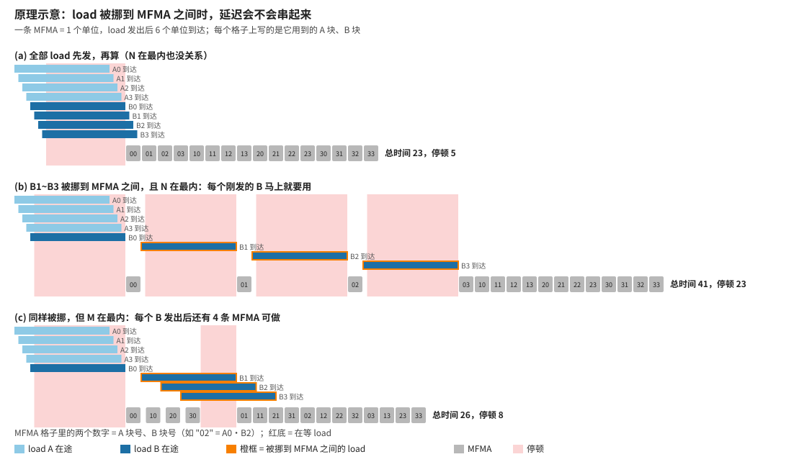
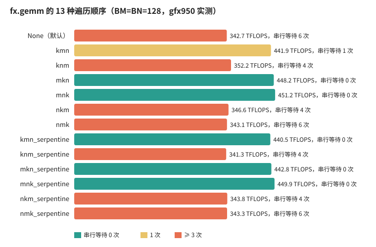
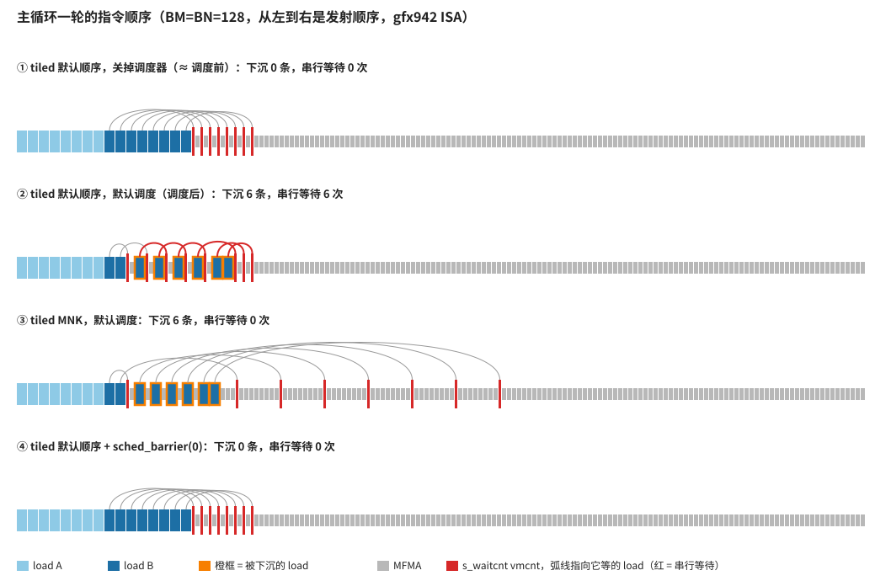
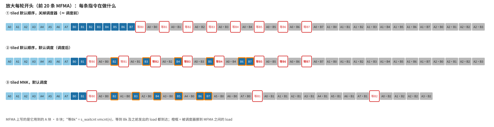
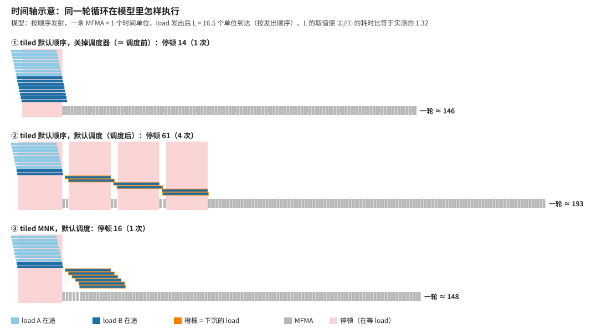
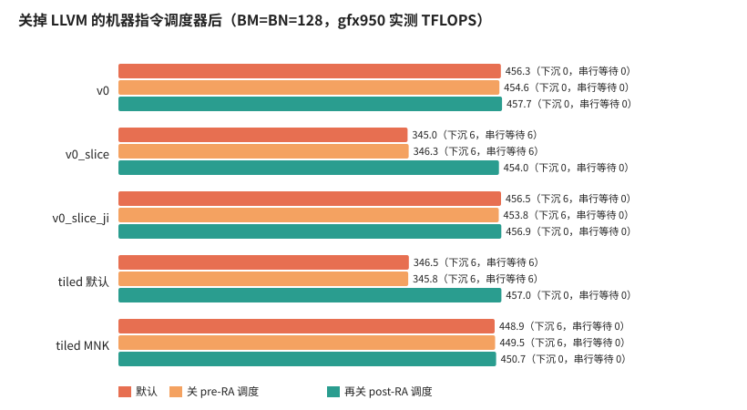

# pipeline_101：编译器的"隐式流水"——为什么同一个 GEMM 有时慢 25%

[tiled_vs_manual](../tiled_vs_manual.ipynb) 里发现：同一个 GEMM（BM=BN=128，1 个 wave，每轮直接从 global 读 A/B 再做 MFMA），只改 `fx.gemm` 的遍历顺序，或者只改手写版 v0 的两行地址写法，性能就在约 455 和约 345 TFLOPS 两档之间跳。本实验把原因找出来：**LLVM 的 post-RA 指令调度器会把一部分 load 挪到 MFMA 之间；如果紧接着的 MFMA 就要用这些 load 的数据，每次访存延迟都会完整地串行暴露出来。**

## 结论

1. 源码里没有写任何流水，但编译器会在**一轮循环内部**重排指令，让 load 和不依赖它的 MFMA 重叠。它不做跨迭代的流水：下一轮的 load 要到回跳之后才发出。
2. 16 条 load 本来都在 MFMA 之前发出。默认设置下，**post-RA 调度器**把其中 6 条挪进了 MFMA 之间（本文叫"下沉"）。
3. 一条被下沉的 load 要等前一次 `s_waitcnt` 结束才发出，它的延迟没法和前面的等待重叠。如果下一条 MFMA 就要用它，就得再等一个完整的延迟。本文把这种等待叫"**串行等待**"。
4. **快慢只取决于有没有串行等待**：13 种遍历顺序、5 个手写 / tiled 版本，串行等待 0～1 次的都在约 440～460 TFLOPS，3 次以上的都在约 340～355。
5. MFMA 的计算次序决定被下沉的 load 多快被用到。`fx.copy` 先发 A 后发 B，被下沉的是 B。M 在最内层（`MNK`、`MKN`）时，每个 B 块要等 8 条 MFMA 之后才用到，所以没事；N 在最内层（默认顺序、`NMK`）时，每个刚下沉的 B 马上就要用。
6. 三组干预实验确认了因果关系：
   - 对调 A、B 的 copy 顺序，快慢整体反转；
   - 手写版重现了同样的现象，并能用同样的办法修好；
   - 关掉 post-RA 调度器后，所有版本都约 455，差距消失。
7. 原版 v0 快，是因为它的 16 条 load 恰好一条都没被下沉。手写并没有让人"控制"住调度。
8. 不用改编译选项也能修：在 copy 和 `fx.gemm` 之间加一个 `rocdl.sched_barrier(0)`，调度器就不能把 load 挪过去，默认顺序也能达到约 455。更根本的办法是跨迭代预取，或用 `sched_group_barrier` 显式规定 load 和 MFMA 的交错方式。

性能是在本机 gfx950（MI350）上测的，ISA 统计按 gfx942 编译。五个版本在 gfx942 和 gfx950 上生成的主循环完全相同（`results/report.txt` 第 3 节的最后一列）。

## 文件

| 文件 | 内容 |
|---|---|
| [common.py](common.py) | 编译 / 导出 ISA、主循环统计（下沉、串行等待）、计时；tiled 版 kernel；v0 的两个变体直接用 [v0.py](../../kernels/gemm/v0.py) 的编译期参数 `SLICE` / `INNER` 生成 |
| [run.py](run.py) | 跑全部实验，写 `results/` |
| [make_figs.py](make_figs.py) | 读 `results/` 画 `figs/*.svg` |
| [results/report.txt](results/report.txt) | 全部表格（本文的数字都来自这里） |
| `results/results.json` | 同样的数据，供画图用 |
| `results/isa/*.s` | 各版本、各调度设置下的主循环 ISA |

复现：

```bash
cd flydsl/pipeline_101
python run.py          # 几分钟，需要 GPU；写 results/
python make_figs.py    # 只读 results/，不需要 GPU
```

## 1. 先看原理（小例子）

主循环一轮里只有三种指令要关心：

- `global_load_dwordx4`：发出一次读，数据要过一段时间（访存延迟）才写进寄存器；
- `s_waitcnt vmcnt(n)`：等到"除了最近发出的 n 条，之前的 load 都已完成"。load 按发出顺序完成计数，等一条 load 就要连同它之前发出的一起等（见 [waitcnt_101](../waitcnt_101.ipynb)）；
- `v_mfma`：矩阵乘加，要用 load 读进来的 A 块、B 块。

"流水"指 load 在途的时候 MFMA 不闲着。下图用 4 个 A 块、4 个 B 块、16 条 MFMA 的小例子说明（简化模型：一条 MFMA = 1 个时间单位，load 发出 6 个单位后到达）：



- **(a)** 8 条 load 一开始全部发出，延迟互相重叠，只在开头停顿一次。这时 MFMA 按什么顺序做都可以。
- **(b)** B1～B3 被挪到 MFMA 之间，而 MFMA 的顺序是 N 在最内（`00 01 02 03`，A0 依次乘 B0～B3）。B1 一发出，下一条 MFMA `01` 就要用它，只好干等一整个延迟；B2、B3 也一样。三次延迟串了起来，总时间从 23 变成 41。
- **(c)** 同样被挪，但 M 在最内（`00 10 20 30`，B0 依次乘 A0～A3）。每个 B 发出后还有 4 条不需要它的 MFMA 可以做，延迟大部分被盖住，总时间 26。

下面用真实的 kernel 证明，128x128 的 GEMM 里发生的正是 (b) 和 (c)。

## 2. 现象：13 种遍历顺序分成两档

`fx.gemm(atom, D, A, B, C, traversal_order=...)` 决定 MFMA 的计算次序，名字的第一个字母是最内层（从 LLVM IR 里 MFMA 调用的顺序确认，见 `results/report.txt` 第 2 节；默认值和 `NMK` 相同）：

| 顺序 | 最内层 | LLVM IR 里的前几条 MFMA（`A0·B1` = A 第 0 块 x B 第 1 块，`+` = 累加在前一条结果上） |
|---|---|---|
| 默认 / `NMK` | N | `A0·B0 A0·B1 A1·B0 A1·B1 …` |
| `MNK` | M | `A0·B0 A1·B0 A0·B1 A1·B1 …` |
| `KMN` | K | `A0·B0 A1·B1+ A2·B0 A3·B1+ …` |

全部 13 种顺序的实测结果：



性能明显分成两档，中间没有过渡：说明原因是一个"有或没有"的东西，而不是逐渐累积的开销。颜色是第 3 节定义的"串行等待"次数，和快慢一一对应。

## 3. 看 ISA：调度前后 load 去了哪里

为了看清"调度前"是什么样子，用 LLVM 选项关掉两个机器指令调度器（`enable-misched=False`、`enable-post-misched=False`）。这时的指令顺序接近调度前的 IR 顺序。下图把每轮循环的指令从左到右排开，每个格子是一条指令：



- **①（调度前）**：16 条 load（浅蓝 A、深蓝 B）全在 MFMA（灰）之前，等待（红竖线）的弧线都连回早已发出的 load。
- **②（调度后，默认顺序）**：6 条 B 被挪到了 MFMA 之间（橙框）。每次等待都连到一条**刚刚**发出的 load（红弧线）。
- **③（调度后，MNK）**：同样有 6 条被挪，但等待出现在 8、15、22…… 条 MFMA 之后，弧线跨得很远。
- **④（默认顺序 + `sched_barrier(0)`）**：load 不再被挪，和 ① 一样。

放大每轮的开头，并把每条指令具体做什么写出来：



② 里的节奏是"发 B2 → 等 B1 → 算 A0·B1 → 发 B3 → 等 B2 → 算 A0·B2 ……"：每条 MFMA 前都要等上一条 MFMA 之前才发出的那个 B。③ 里虽然也是"发一个 B、做一条 MFMA"交替，但做的是 `A1·B0`、`A2·B0`……，用的都是早已到达的 B0，要到 8 条之后才等 B1。

对应的原始 ISA（`results/isa/tiled_default__default.s`，每条 load 写一组 AGPR，MFMA 的第 2、3 个操作数是 A、B）：

```
global_load_dwordx4 a[12:15] ...      ; B0
global_load_dwordx4 a[20:23] ...      ; B1
s_waitcnt vmcnt(1)                    ; 等到只剩 1 条在途 = 等 B0
v_mfma v[244:247], a[60:61], a[12:13] ; A0·B0
global_load_dwordx4 a[24:27] ...      ; B2（被下沉）
s_waitcnt vmcnt(1)                    ; 等 B1
v_mfma v[220:223], a[60:61], a[20:21] ; A0·B1
global_load_dwordx4 a[28:31] ...      ; B3（被下沉）
s_waitcnt vmcnt(1)                    ; 等 B2——它是上一条 MFMA 之前刚发出的
...
```

为了能对所有版本做统计，[common.py](common.py) 的 `load_profile` 从主循环里数出三个量：

- **下沉**：第一条 MFMA 之后才发出的 load 条数；
- **被等 load 已经过的 MFMA**：每次 `s_waitcnt vmcnt` 等的那条 load，从发出到这次等待之间执行了几条 MFMA；
- **串行等待**：等的是一条被下沉的 load，而且它发出后最多只经过了 2 条 MFMA。这种等待几乎完整地暴露一次访存延迟。

五个版本（默认调度）：

| 版本 | TFLOPS | load 顺序 | 下沉 | 串行等待 | 被等 load 已经过的 MFMA |
|---|---|---|---|---|---|
| v0（手写原版） | 454.6 | `ABABABABABABABAB` | 0 | 0 | 1, 2, 3, 5, 9, 10, 11, 14, … |
| v0_slice（先切动态坐标） | 345.4 | `AAAAAAAABBBBBBBB` | 6 | 6 | 1, 1, 1, 1, 1, 1, 1 |
| v0_slice_ji（再把 M 换到内层） | 452.3 | `AAAAAAAABBBBBBBB` | 6 | 0 | 8, 15, 22, 29, 36, 43, 50 |
| tiled 默认顺序 | 346.3 | `AAAAAAAABBBBBBBB` | 6 | 6 | 1, 1, 1, 1, 1, 1, 2 |
| tiled MNK | 449.0 | `AAAAAAAABBBBBBBB` | 6 | 0 | 8, 15, 22, 29, 36, 43, 51 |

## 4. 时间轴：串行等待到底损失了多少

把真实的主循环 ISA 放进第 1 节的简单模型里，就能看到时间是怎样花掉的。模型只有一个参数，即 load 的延迟 L。取 L 使"② / ①"的耗时比等于实测的 457.0 / 346.5 ≈ 1.32，得到 L ≈ 16.5 条 MFMA 的时间：



- ①：只在开头等一次（所有 load 一起在途）；
- ②：除了开头，又有 3 段停顿，每段都是一个被下沉的 B 从发出到到达的完整延迟；
- ③：下沉的 B 和 MFMA 完全重叠，和 ① 几乎一样长。

这只是一个示意模型：一个 SIMD 上实际可能有多个 wave 交替执行，真实延迟也随缓存命中情况变化，所以 L 是"等效延迟"，不是硬件参数。但停顿的**结构**（哪几段、为什么）是由 ISA 本身决定的，不依赖于参数。

## 5. 三个干预实验

只看指标吻合还只是相关性。下面三个实验各改一个变量，先预测结果再测。

### 5.1 对调 A、B 的 copy 顺序

预测：先发 B，被下沉的就变成 A，于是 M 在最内层的顺序会变慢，N 在最内层的会变快。

| 顺序 | 先发 A（TFLOPS / 串行等待） | 先发 B |
|---|---|---|
| 默认 | 342.6 / 6 | 450.5 / 0 |
| `MNK` | 449.3 / 0 | 342.7 / 6 |
| `NMK` | 342.7 / 6 | 449.5 / 0 |
| `KMN` | 441.2 / 1 | 345.4 / 3 |
| `KNM` | 356.3 / 4 | 453.2 / 0 |

五种顺序全部反转。所以没有"本身更快"的遍历顺序。

### 5.2 手写版重现

v0 原版的代码顺序是 N 在 M 的内层（`for i (M): for j (N): for h (K)`），和 tiled 默认顺序一样，但它快。[v0.py](../../kernels/gemm/v0.py) 的 `build_v0` 有两个编译期参数用来生成变体（默认值就是原版，生成的 ISA 和加参数之前逐字节相同）：

```python
if const_expr(SLICE):          # 先用动态坐标切出子 tensor，再用静态下标
    Ak, Bk = A[None, kk, row, None], B[None, kk, row, None]
    a_tile = [Ak[None, i].load().bitcast(fx.Int16) for i in range_constexpr(NI)]
    b_tile = [Bk[None, j].load().bitcast(fx.Int16) for j in range_constexpr(NJ)]
else:                          # 原版：每次从整个大 view 取下标
    a_tile = [A[None, kk, row, i].load().bitcast(fx.Int16) for i in range_constexpr(NI)]
    b_tile = [B[None, kk, row, j].load().bitcast(fx.Int16) for j in range_constexpr(NJ)]
...
# INNER="N"：(i, j) 按 for i: for j 遍历；INNER="M"：按 for j: for i 遍历
for t in range_constexpr(NI * NJ):
    i, j = TILES[t]
```

在 [tiled_vs_manual](../tiled_vs_manual.ipynb) 4.1 节里，为了减少地址计算我们用了 `SLICE=True`（`v0_slice`）。
地址计算确实少了，但第 3 节的表显示它也开始下沉 6 条 load，掉到约 345。按机制预测，再把 M 换到内层（`v0_slice_ji` = `SLICE=True, INNER="M"`）就能恢复，实测 452。可见这和用不用 tiled 无关。

### 5.3 关掉调度器：是谁挪的

LLVM 后端有两个机器指令调度器：寄存器分配之前的（pre-RA，主要权衡寄存器压力和延迟）和之后的（post-RA，主要处理延迟和硬件冒险）。



- 只关 pre-RA：几乎没有变化。慢的仍然下沉 6 条、串行等待 6 次。v0 的 load 顺序从 ABAB 变成先 A 后 B，但仍然不下沉、仍然快：说明 v0 快和 ABAB 交替无关。
- 再关 post-RA：五个版本都不再下沉 load，全部约 450～460，差距消失。

所以下沉是 post-RA 调度器做的。它为什么这样挪，我的推测是：它想用独立的 load 填补 MFMA 之间的空隙，但没有考虑 load 一旦落在某次等待之后，延迟就会被串起来。这一点没有核对调度器源码。

关调度器是整个 kernel 的全局开关，会连带取消其他地方有用的重排，只适合用来定位问题。

### 5.4 不改编译选项的修法：sched_barrier

在 copy 和 `fx.gemm` 之间加一行 `fx.rocdl.sched_barrier(0)`（mask 0 = 任何指令都不能被调度器移过这里）：

| 版本 | TFLOPS | 下沉 | 串行等待 |
|---|---|---|---|
| tiled 默认顺序 | 342.4 | 6 | 6 |
| tiled 默认顺序 + `sched_barrier(0)` | 454.5 | 0 | 0 |
| tiled MNK | 454.9 | 6 | 0 |
| tiled MNK + `sched_barrier(0)` | 457.5 | 0 | 0 |

load 被留在 MFMA 之前，默认顺序也能达到约 455（`issue_order.svg` 第 ④ 行）。

## 6. 怎样避免

按从弱到强的顺序：

1. **让最后发出的操作数在 MFMA 循环里变化最慢**：搭配 copy 顺序和 `traversal_order`（手写版就是循环嵌套顺序）。这样即使 load 被下沉，也有足够的 MFMA 掩盖。但这只是给调度器一个好的起点，换 tile 大小、换架构要重新检查。
2. **用 `sched_barrier` 把 load 和计算隔开**：5.4 节一行就够。缺点是调度器也不能再把这一轮的 load 和 MFMA 交错，只剩一次"全部发出、再统一等"。
3. **跨迭代预取**：本轮 MFMA 用的是上一轮就已发出的数据，等待自然落在早已到达的 load 上，对顺序和调度都不敏感。[tiled_vs_manual](../tiled_vs_manual.ipynb) 第 6 节带 LDS 的版本里，只挪两行 `fx.copy` 做预取，就从约 530 提到约 585 TFLOPS，默认顺序和 MNK 也只差约 1%。
4. **显式规定交错方式**：`rocdl.sched_group_barrier`（`sched_mfma` / `sched_vmem` / `sched_dsrd` 等）指定每几条 MFMA 插一条 load，[v2.py](../../kernels/gemm/v2.py) 就是这样做的。

无论哪种，都要以 ISA 为准：本文的 `load_profile`（下沉、串行等待）可以直接拿去检查其他 kernel 的主循环。

## 7. 回顾：这个原因是怎样找到的

1. **受控对照，先排除便宜的解释**：同样的 tile、编译选项和计时方法，先保证结果正确。MFMA 条数、load 条数、VGPR 都相同，也没有 spill，说明问题在指令的排列，而不在指令本身。
2. **扫参数，找突变**：13 种遍历顺序分成两档，说明原因是二元的。
3. **提出假设，用全部样本检验**：先后试过"`vmcnt(0)` 之前的 MFMA 数"和"K 在最内层造成累加器依赖"两个假设，都只能解释部分顺序，被放弃。
4. **回到上游找事实**：小 tile 时 13 种顺序的 ISA 完全一样（调度器重排了 MFMA），所以改看 LLVM IR，才确认了顺序名字的含义。
5. **设计直接刻画机制的指标**：先用"load 顺序 + 相邻两次等待之间的 MFMA 数"，它能区分 tiled 的各种顺序，但关掉 pre-RA 调度器以后，v0 的指标变得和慢版本一样，性能却不变。于是改成"下沉 + 串行等待"。这个指标在所有设置下都和快慢一一对应。
6. **干预确认因果**：对调 copy 顺序（5.1）、手写版重现（5.2）、关调度器（5.3）、`sched_barrier`（5.4），每次都先预测、再测。

几个容易踩的坑：

- 在我关掉调度器做对照之前，一度以为"v0 快是因为 A、B 交替发出"，而当时的指标也支持这个解释；
- 指标在部分样本上吻合，不等于抓住了机制；
- 看到的差异不一定是瓶颈：手写版先切动态坐标省下的地址计算是真实的，但这个 kernel 是 MFMA 受限的，省下的 VALU 对性能没有影响。

## 8. 局限

- 时间轴是示意模型，没有直接测停顿周期。更直接的证据可以用 rocprofv3 的计数器（`SQ_WAIT_INST_ANY`、`SQ_BUSY_CYCLES` 等）或 thread trace 去拿。
- "下沉"和"串行等待"按寄存器是否重叠来判断 load 属于 A 还是 B、哪条 MFMA 用了它，是启发式的；寄存器复用很多的 kernel 里可能误判。
- 只研究了"直接从 global 读、无预取、1 个 wave"这一种结构。带 LDS、多 wave、有预取的 kernel，主导因素可能不同（例如 v2 的瓶颈在 LDS 读写和 MFMA 的交错）。
