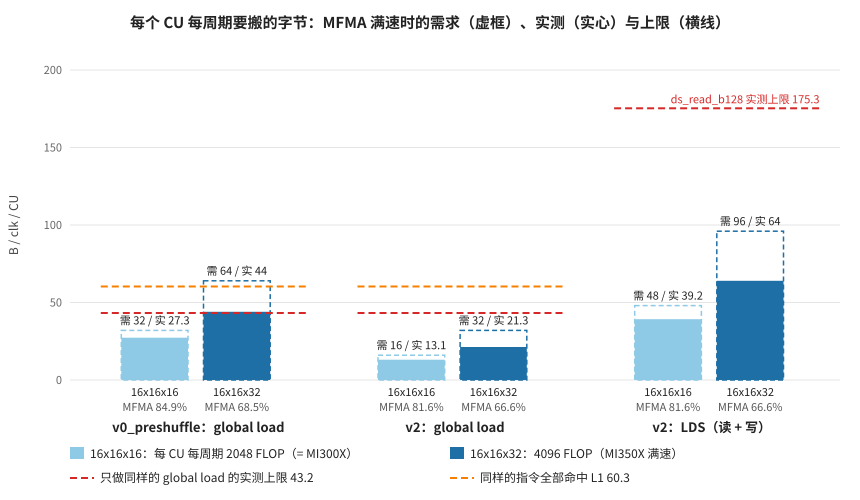

# roofline_101：算力翻倍、带宽没翻倍，v0_preshuffle 为什么在 MI350X 上到顶

问题：在 MI300X 上，[v0_preshuffle](../../kernels/gemm/v0_preshuffle.py)（不用 LDS，每个 wave 自己读数）比 [v2](../../kernels/gemm/v2.py)（4 个 wave 经 LDS 共享）还快；MI350X 的算力翻倍、带宽却没翻倍，这条路线为什么就走不通了？

做法：把每个 CU 每个周期**要搬多少字节**（由 tile 形状算出）和**能搬多少字节**（用只做访存的小 kernel 实测）放在一起比较。本机只有 MI350X（gfx950），MI300X 的算力用 16x16x16 MFMA 模拟：这条指令在 gfx950 上每个 SIMD 每周期 512 FLOP，和 MI300X 一样（[kernels/gemm §4.1](../../kernels/gemm/README.md#41-gfx950mi350x上和-torchmatmul-的差距) 用计数器验证过）。

## 结论



1. **先更正一个前提：在 MI350X 上，v0_preshuffle 现在也不比 v2 慢。** 两者都用 16x16x32 时是 1093 对 1079 TFLOPS，都用 16x16x16 时是 795 对 779（[实验 2](#实验-2两个-gemm16x16x16-与-16x16x32)）。真正的差别在**还能不能再快**：v0_preshuffle 已经到了硬件上限，v2 离上限还很远。和 v2 同样 tile 形状（256×256×64，4 wave）的 hipBLASLt kernel 能做到 1230 TFLOPS。

2. **翻倍的只有算力，每个 CU 的 L1 通路没有翻倍。** 每个 CU 每周期的 BF16 MFMA 从 2048 FLOP 涨到 4096 FLOP；L1 每个 CU 每周期仍约 64 B（MI300X 约每周期 1 次 64 B 访问；本机实测全部命中 L1 时 60 B，[实验 3](#实验-3global-load-的上限)）。CU 数从 304 降到 256，整卡的 L1 总带宽反而略降。HBM 涨了 1.5 倍，但这里用不到（L2 之外只读约 1.6 GB，每秒约 1.6 TB）。

3. **v0_preshuffle 每 64 FLOP 要过 1 B 的 L1。** 每个 wave 每个 K 步读 16 KB、做 2×128×128×32 FLOP，wave 之间不共享（[实验 1](#实验-1需求由-tile-形状算出)）。
   - MFMA 满速时，MI300X 的算力需要 32 B/clk/CU，低于这种 load 的实测上限 43 B/clk/CU：TA 只忙一半（本机模拟 54%，MI300X 实测 49%），MFMA 忙碌 85%（MI300X 79%）。不经过 LDS，也就省了 ds_write、barrier，所以比 v2 稍快。
   - MI350X 满速时需要 64 B/clk/CU，超出上限 43：MFMA 最多忙 43 ÷ 64 = 67%，实测 68.5%，TA 忙碌 94%。只做同样 load、不做 MFMA 的 kernel 每周期也只取 43.2 B；v0_preshuffle 是 44.0 B（[实验 3](#实验-3global-load-的上限)）。也就是说，MFMA 已经全部藏在 load 后面，**按周期算不可能再快**。

4. **v2 把一半流量转到了 LDS，而 LDS 带宽是够的。** 4 个 wave 共享 256×256 的 tile，global 只要 1/128 B/FLOP，MI350X 满速时 32 B/clk/CU，低于 43；其余搬到 LDS（读 + 写）需要 96 B/clk/CU，而本机实测 LDS 读至少 175 B/clk/CU（[实验 4](#实验-4lds-读的上限)）。两条路都不卡带宽，v2 现在只忙 66.6%，原因在它的指令安排：这套流水是按 MI300X 的 16x16x16 排的，换成 16x16x32 后每个 region 的 MFMA 时间减半，ds_write 等访存却没变，盖不住了。去掉 ds_write（load 直写 LDS）、多级缓冲就能继续往上走，这正是 hipBLASLt 的做法（[kernels/gemm §4.1](../../kernels/gemm/README.md#41-gfx950mi350x上和-torchmatmul-的差距)）。注意 load 直写 LDS 仍然经过 TA/L1/L2，只省掉 ds_write 和中转寄存器，不减少 L1 流量（[问答](#问答load-直写-lds-会绕开-tal1l2-吗)）。

5. **怎么选**：一个 wave 自己读数，每 FLOP 要搬的字节由 wave tile 决定（128×128 已经用到 512 个寄存器的上限，没法再大）；跨 wave 共享（LDS）才能把每 CU 的 global 流量再降一半。算力/带宽比每涨一代，前者就更早碰到 L1 的墙。

## 两代硬件：每个 CU 每周期

| | MI300X（gfx942） | MI350X（gfx950） | 比值 | 来源 |
|---|---|---|---|---|
| CU × 标称主频 | 304 × 2.1 GHz | 256 × 2.2 GHz | | 标称值 |
| BF16 MFMA，FLOP/clk/CU | 2048 | 4096（16x16x32）/ 2048（16x16x16） | **2×** | 计数器验证（[§4.1](../../kernels/gemm/README.md#41-gfx950mi350x上和-torchmatmul-的差距)） |
| 整卡 BF16 峰值 | 1307 TFLOPS | 2307 TFLOPS | 1.77× | 上两行相乘 |
| L1，B/clk/CU | 约 64（约 1 次 64 B 访问/clk） | 约 64（实测命中 L1 60.3） | **1×** | [§1.4](../../kernels/gemm/README.md#14-优化寄存器双缓冲ilp-输入预重排) / [实验 3](#实验-3global-load-的上限) |
| 整卡 L1 | 约 41 TB/s | 约 36 TB/s | 0.88× | 上两行相乘 |
| LDS，B/clk/CU | 128 | 实测 ds_read_b128 至少 175 | ≥ 1.4× | [§3.7](../../kernels/gemm/README.md#37-指令调度rocdlsched_) / [实验 4](#实验-4lds-读的上限) |
| HBM | 5.3 TB/s | 8 TB/s | 1.5× | 标称值 |

## 实验

全部由 [run.py](run.py) 完成：`python run.py` 依次用 rocprofv3 跑下面 7 个 case，写 [results/report.txt](results/report.txt) 和 results/results.json；`python run.py run <case>` 只跑一个 case（可以自己套 rocprofv3 或 dump ISA）。[make_figs.py](make_figs.py) 画图。GEMM 都是 8192³ bf16 → fp32。

| case | 内容 | 见 |
|---|---|---|
| `v0p_k16` / `v0p_k32` | `build_v0_preshuffle(128, 128, ..., K32=False/True)` | 实验 2 |
| `v2_k16` / `v2_k32` | `build_v2(256, 256, ..., K32=False/True)` | 实验 2 |
| `load_v0` | 只 load：与 v0_preshuffle 相同的 grid、相同的 16 条 `global_load_dwordx4`/K 步、同样的寄存器双缓冲；MFMA 换成几条加法 | 实验 3 |
| `load_hit` | 同样的指令，但所有 wave 只读同一块 16 KB，每步换一个顺序，全部命中 L1 | 实验 3 |
| `lds_read` | 4 wave/block、16 KB LDS，`ds_read_b128`，每个 wave 读连续 1 KB，无 bank conflict | 实验 4 |

### 实验 0：怎么测、怎么换算

- 每个 case 在一个单独进程里跑 40 + 10 次，每次用一份新拷贝的输入；前 40 次是热身（连续跑约 30 次后主频才稳定），只用后 10 次 dispatch。
- rocprofv3 分两次运行采两组计数器（一次采不了太多 TA 计数器，放在一组里 rocprofv3 会卡住），第一次同时记 kernel 时间。
- 换算：周期 = `GRBM_GUI_ACTIVE` ÷ 8（8 个 XCD 之和）；主频 = 周期 ÷ 时间；每 CU 的量 = 总数 ÷ 256 ÷ 周期。global 字节 = `SQ_INSTS_VMEM_RD` × 1 KB（这些 kernel 的 load 都是 64 lane × 16 B），LDS 字节 = `SQ_INSTS_LDS` × 1 KB（都是 `_b128`）。

<details><summary>代码：每个 case 跑什么（<code>run()</code>，由 rocprofv3 调用）</summary>

```python
def run(case):
    sys.path.insert(0, GEMM)
    import torch
    import flydsl.compiler as flyc
    import flydsl.expr as fx
    from v0_preshuffle import build_v0_preshuffle, preshuffle
    from v2 import build_v2

    hints = {"opt_level": 2, "llvm_options": {"amdgpu-mfma-vgpr-form": False}}
    st = fx.Stream(torch.cuda.current_stream().cuda_stream)
    torch.manual_seed(0)
    if case == "lds_read":
        C = torch.zeros(4 * 256 * LDS_BLK, device="cuda")
        f = flyc.compile[hints](build_lds_read(LDS_BLK, LDS_ITER), C, st)
        reps = [() for _ in range(WARMUP + ITERS)]
        fn = lambda: f(C, st)
    else:
        A = torch.randn(M, K, dtype=torch.bfloat16, device="cuda") / math.sqrt(K)
        B = torch.randn(N, K, dtype=torch.bfloat16, device="cuda") / math.sqrt(K)
        C = torch.zeros(M, N, dtype=torch.float32, device="cuda")
        k32 = case.endswith("k32")
        if case.startswith("v2"):
            launcher = build_v2(256, 256, 1, M, N, K, K32=k32)
        else:
            A, B = preshuffle(A), preshuffle(B)
            if case.startswith("v0p"):
                launcher = build_v0_preshuffle(128, 128, 1, M, N, K, K32=k32)
            else:
                launcher = build_load_only(M, N, K, HIT=case == "load_hit")
        f = flyc.compile[hints](launcher, A, B, C, st)
        reps = [(A.clone(), B.clone()) for _ in range(WARMUP + ITERS)]
        fn = lambda a, b: f(a, b, C, st)
    torch.cuda.synchronize()
    for r in reps:
        fn(*r)
        torch.cuda.synchronize()
```

</details>

<details><summary>代码：rocprofv3 采集（<code>GROUPS</code> / <code>rocprof()</code> / <code>counters()</code>）</summary>

```python
GROUPS = [
    "GRBM_GUI_ACTIVE SQ_VALU_MFMA_BUSY_CYCLES TA_TA_BUSY",
    "SQ_INSTS_VMEM_RD SQ_INSTS_LDS TA_ADDR_STALLED_BY_TC_CYCLES TA_DATA_STALLED_BY_TC_CYCLES",
]
KERNELS = ("gemm_", "load_only", "lds_read")

def rocprof(case, args):
    with tempfile.TemporaryDirectory() as d:
        subprocess.run(["rocprofv3", *args, "-d", d, "-o", "out", "-f", "csv", "--",
                        sys.executable, os.path.abspath(__file__), "run", case],
                       check=True, capture_output=True, cwd=d)
        out = {}
        for name in ["kernel_trace", "counter_collection"]:
            paths = glob.glob(f"{d}/**/*{name}.csv", recursive=True)
            if paths:
                out[name] = [r for r in csv.DictReader(open(paths[0])) if r["Kernel_Name"].startswith(KERNELS)]
        return out

def counters(case):
    vals = {}
    for i, g in enumerate(GROUPS):
        res = rocprof(case, (["--kernel-trace"] if i == 0 else []) + ["--pmc", *g.split()])
        if i == 0:
            us = sorted((int(r["End_Timestamp"]) - int(r["Start_Timestamp"])) / 1e3 for r in res["kernel_trace"][WARMUP:])
            vals["us"] = us[len(us) // 2]
        per = collections.defaultdict(lambda: collections.defaultdict(float))
        for r in res["counter_collection"]:
            per[r["Dispatch_Id"]][r["Counter_Name"]] += float(r["Counter_Value"])
        disp = list(per.values())[WARMUP:]
        for name in g.split():
            vals[name] = sum(d[name] for d in disp) / len(disp)
    return vals
```

</details>

<details><summary>代码：换算成每 CU 每周期（<code>summarize()</code>）</summary>

```python
def summarize(case, c):
    cyc = c["GRBM_GUI_ACTIVE"] / XCD                    # GRBM_GUI_ACTIVE 是 8 个 XCD 之和
    per_cu = lambda x: x / CU / cyc
    row = {
        "时间 (us)": round(c["us"], 1),
        "主频 (MHz)": round(cyc / c["us"]),
        "周期 (M)": round(cyc / 1e6, 3),
    }
    if case[:2] in ("v0", "v2"):
        row["TFLOPS"] = round(2 * M * N * K / c["us"] / 1e6, 1)
        row["MFMA 忙碌"] = f'{per_cu(c["SQ_VALU_MFMA_BUSY_CYCLES"]) / 4:.1%}'
    row["TA 忙碌"] = f'{per_cu(c["TA_TA_BUSY"]):.1%}'
    row["TA 被 L1 反压"] = f'{per_cu(c["TA_ADDR_STALLED_BY_TC_CYCLES"] + c["TA_DATA_STALLED_BY_TC_CYCLES"]):.1%}'
    row["global load B/clk/CU"] = round(per_cu(c["SQ_INSTS_VMEM_RD"] * 1024), 1)    # 每条 1 KB
    row["LDS B/clk/CU"] = round(per_cu(c["SQ_INSTS_LDS"] * 1024), 1)                # 每条 ds_*_b128 1 KB
    return row
```

</details>

### 实验 1：需求（由 tile 形状算出）

MFMA 100% 忙时，每个 CU 每周期要搬的字节，与硬件无关：

| | FLOP/clk/CU | global B/clk/CU | LDS B/clk/CU |
|---|---|---|---|
| v0p，16x16x16 | 2048 | 32 | 0 |
| v0p，16x16x32 | 4096 | **64** | 0 |
| v2，16x16x16 | 2048 | 16 | 48 |
| v2，16x16x32 | 4096 | 32 | 96 |

- v0p：每个 wave 每个 K 步（K = 32）读 8 个 A + 8 个 B 向量，共 16 KB，做 2×128×128×32 FLOP，即 1/64 B/FLOP。
- v2：每个 CTA 每个 K 步（K = 64）从 global 读 (256 + 256)×64×2 B = 64 KB，做 2×256×256×64 FLOP，即 1/128 B/FLOP；LDS 先写这 64 KB，再由 4 个 wave × 4 个 region × 8 条 1 KB 读出 128 KB。

<details><summary>代码：<code>demand()</code></summary>

```python
def demand():
    """MFMA 100% 忙时，每个 CU 每周期要搬多少字节（由 tile 形状算出，与硬件无关）"""
    flop_v0 = 2 * 128 * 128 * 32                       # 一个 wave 一个 K 步（K=32）
    bytes_v0 = 16 * 1024                               # 8 个 A + 8 个 B 向量
    flop_v2 = 2 * 256 * 256 * 64                       # 一个 CTA 一个 K 步（K=64）
    gl_v2 = (256 + 256) * 64 * 2                       # global：A、B 各 256 行 x 64 K
    lds_v2 = gl_v2 + 4 * 4 * 8 * 1024                  # LDS：写一遍 + 4 个 wave x 4 个 region x 8 条 1 KB 读
    rows = {}
    for name, fpc in [("k16", 4 * 512), ("k32", 4 * 1024)]:
        rows[f"v0p_{name}"] = {"FLOP/clk/CU": fpc, "global B/clk/CU": fpc * bytes_v0 / flop_v0, "LDS B/clk/CU": 0}
        rows[f"v2_{name}"] = {"FLOP/clk/CU": fpc, "global B/clk/CU": fpc * gl_v2 / flop_v2,
                             "LDS B/clk/CU": fpc * lds_v2 / flop_v2}
    return rows
```

</details>

### 实验 2：两个 GEMM，16x16x16 与 16x16x32

同一个 kernel 只换 MFMA 指令：16x16x16 每 CU 每周期 2048 FLOP（= MI300X），16x16x32 是 4096 FLOP。每个 lane 的 16 B 本来就是 8 个连续 K，正好是 16x16x32 的一份操作数，所以开关 `K32` 只改 `dot()`（v2 还要把每个 region 的 MFMA 数从 64 改成 32）。

| case | TFLOPS | 主频 | MFMA 忙碌 | TA 忙碌 | TA 被 L1 反压 | global B/clk/CU（需求） | LDS B/clk/CU（需求） |
|---|---|---|---|---|---|---|---|
| v0p_k16 | 795 | 1786 MHz | 84.9% | 54.2% | 2.1% | 27.3（32） | 0 |
| v0p_k32 | **1093** | 1522 MHz | 68.5% | **94.1%** | 7.4% | **44.0**（64） | 0 |
| v2_k16 | 779 | 1820 MHz | 81.6% | 25.4% | 2.0% | 13.1（16） | 39.2（48） |
| v2_k32 | 1079 | 1544 MHz | 66.6% | 42.6% | 4.8% | 21.3（32） | 64.0（96） |

MI300X 的对照数据取自 [kernels/gemm §1.4](../../kernels/gemm/README.md#14-优化寄存器双缓冲ilp-输入预重排)（8192×9728×8192）：v0_preshuffle 662 TFLOPS、MFMA 79%、TA 49%；v2 641 TFLOPS、MFMA 78%、TA 37%。

- **实测 ≈ 需求 × MFMA 忙碌**：例如 v0p_k32 64 × 68.5% = 43.8，实测 44.0；v2_k32 的 LDS 96 × 66.6% = 64，实测 64.0。说明实验 1 的算法和实验 0 的计数口径是对的。
- **周期是比较的单位**：主频随负载在 1.5～2.2 GHz 之间变（MFMA 越忙越低），所以全用“每周期”比较。
- 16x16x16 时，两个 kernel 的 TA、MFMA 忙碌和 MI300X 实测接近，v0p 稍快；16x16x32 时 v0p 的 TA 到了 94%。

<details><summary>代码：v0_preshuffle 的 <code>dot()</code>（<a href="../../kernels/gemm/v0_preshuffle.py">v0_preshuffle.py</a>）</summary>

```python
def dot(acc, ab):
    """NI x NJ blocks x two K16 MFMAs per 16 B chunk (same as v0),
    or one K32 MFMA per 16 B chunk (K32, gfx950)"""
    acc = list(acc)
    if const_expr(K32):
        for i in range_constexpr(NI):
            for j in range_constexpr(NJ):
                acc[i * NJ + j] = rocdl.mfma_f32_16x16x32_bf16(
                    T.f32x4, [ab[i], ab[NI + j], acc[i * NJ + j], 0, 0, 0])
        return acc
    a = [v.bitcast(fx.Int16) for v in ab[:NI]]
    b = [v.bitcast(fx.Int16) for v in ab[NI:]]
    for i in range_constexpr(NI):
        for j in range_constexpr(NJ):
            for h in range_constexpr(2):
                sel = [4 * h + e for e in range(4)]
                acc[i * NJ + j] = rocdl.mfma_f32_16x16x16bf16_1k(
                    T.f32x4, [a[i].shuffle(a[i], sel), b[j].shuffle(b[j], sel),
                              acc[i * NJ + j], 0, 0, 0])
    return acc
```

</details>

<details><summary>代码：v2 的 <code>dot()</code> 与 <code>interleave()</code>（<a href="../../kernels/gemm/v2.py">v2.py</a>）</summary>

```python
def dot(acc, a_op, b_op):
    """DOT: 64 MFMAs (4x4 blocks x K=64) on one quadrant slice (32 with K32)"""
    acc = list(acc)
    if const_expr(K32):
        for s in range_constexpr(2):
            for i in range_constexpr(NI):
                for j in range_constexpr(NJ):
                    acc[i * NJ + j] = rocdl.mfma_f32_16x16x32_bf16(
                        T.f32x4, [a_op[s * NI + i], b_op[s * NJ + j], acc[i * NJ + j], 0, 0, 0])
        return acc
    ...  # 16x16x16：同 v0_preshuffle，每个 16 B 拆成两条

def interleave(n_dsrd, n_dswr, n_vmem):
    if const_expr(SCHED):
        for _ in range_constexpr(n_dsrd):
            rocdl.sched_mfma(2)
            rocdl.sched_dsrd(1)
        for _ in range_constexpr(n_dswr):
            rocdl.sched_mfma(2)
            rocdl.sched_dswr(1)
        for _ in range_constexpr(n_vmem):
            rocdl.sched_mfma(1)
            rocdl.sched_vmem(1)
        rocdl.sched_mfma((32 if K32 else 64) - 2 * n_dsrd - 2 * n_dswr - n_vmem)
```

`interleave` 是按 16x16x16 的节奏排的：每次 LDS 访问配 2 条 MFMA。换成 16x16x32 后一个 region 只有 32 条 MFMA，访存条数不变，节奏就不对了。

</details>

### 实验 3：global load 的上限

把 v0_preshuffle 的 MFMA 去掉，只留同样的 load，看每 CU 每周期最多能取多少字节；再让同样的指令全部命中 L1，看 L1 本身的上限。

| case | 主频 | TA 忙碌 | TA 被 L1 反压 | global B/clk/CU |
|---|---|---|---|---|
| load_v0（与 v0p 相同的 load） | 2204 MHz | 98.3% | 12.4% | **43.2** |
| load_hit（全部命中 L1） | 2216 MHz | 94.8% | 0.0% | 60.3 |
| 对照：v0p_k32 | 1522 MHz | 94.1% | 7.4% | 44.0 |

- **v0p_k32 已经在上限上**：只 load 的 kernel 主频高得多，但每周期取的字节和 v0p_k32 一样。MFMA 最多忙 43.2 ÷ 64 = 67%，实测 68.5%。
- **TA 忙碌不等于被缓存卡住**：v0p_k32 TA 忙 94%，被 L1 反压只有 7%。TA 一直在处理指令，上限来自整条通路（TA → L1 → TD，不命中时还要等 L2）；不命中时 43、全命中时 60，具体卡在哪一级，现有计数器分辨不出来。
- v2_k32 的 global 需求是 32，低于 43.2，不受这个上限限制。

<details><summary>代码：<code>build_load_only()</code>（load_v0 / load_hit）</summary>

```python
def build_load_only(M, N, K, HIT=False):
    NK, NI = K // 32, 8
    grid, block = (M // 128, N // 128, 1), (64, 1, 1)

    @flyc.kernel(known_block_size=block)
    def load_only(A: fx.Tensor, B: fx.Tensor, C: fx.Tensor):
        tid = fx.thread_idx.x
        bid_m, bid_n = fx.block_idx.x, fx.block_idx.y
        # 和 v0_preshuffle 一样的视图：一条 load 是 64 lane x 16 B = 连续 1 KB
        A = fx.make_view(fx.get_iter(A), fx.make_ordered_layout((8, 64, NK, NI, grid[0]), 0))
        B = fx.make_view(fx.get_iter(B), fx.make_ordered_layout((8, 64, NK, NI, grid[1]), 0))
        C = fx.make_view(fx.get_iter(C), fx.make_ordered_layout((4, 64, grid[0], grid[1]), 0))
        if const_expr(HIT):
            A, B = A[None, None, None, None, 0], B[None, None, None, None, 0]
        else:
            A, B = A[None, None, None, None, bid_m], B[None, None, None, None, bid_n]

        def gr(k):
            if const_expr(HIT):   # 只读 K 步 0 的 16 KB，每步换个顺序，地址随循环变
                return [X[None, tid, 0, (i + k * 5) % NI].load() for X in (A, B) for i in range_constexpr(NI)]
            return [X[None, tid, k, i].load() for X in (A, B) for i in range_constexpr(NI)]

        def use(acc, vs):         # 代替 MFMA：把数据加进累加器，免得 load 被删掉
            for v in vs:
                acc = acc + v.bitcast(fx.Float32)
            return acc

        # 和 v0_preshuffle 的 ILP 一样：一次迭代两个 K 步，两组寄存器轮换，循环末尾不用拷贝。
        # sched_barrier 让 load 留在原位，否则 LLVM 会把它们挪到使用处附近。
        acc0 = [fx.full(4, 0.0, fx.Float32), fx.full(4, 0.0, fx.Float32)]
        for k, st in range(fx.Index(0), fx.Index(NK // 2), fx.Index(1), init=acc0 + gr(fx.Int32(0))):
            st = list(st)
            kt = fx.Int32(k) * 2
            nxt = gr(kt + 1)
            rocdl.sched_barrier(0)
            acc = use(st[0], st[2:])
            cur = gr((kt + 2) % NK)
            rocdl.sched_barrier(0)
            acc = use(acc, nxt)
            results = yield [acc, st[1]] + cur
        C[None, tid, bid_m, bid_n].store(list(results)[0])

    @flyc.jit
    def launcher(A: fx.Tensor, B: fx.Tensor, C: fx.Tensor, stream: fx.Stream):
        load_only(A, B, C).launch(grid=grid, block=block, stream=stream)

    return launcher
```

</details>

<details><summary>检查：load_v0 的循环确实一直有 16～32 条 load 在途</summary>

如果不加 `sched_barrier`，LLVM 会把 load 挪到使用处附近，每次迭代末尾 `vmcnt(0)` 等空，测出来的就不是上限了。

```bash
FLYDSL_DUMP_IR=1 FLYDSL_DUMP_DIR=/tmp/rl python run.py run load_v0
L=/tmp/rl/load_only_0/22_final_isa.s
awk '/^.LBB0_1/,/s_cbranch/' $L | grep -c global_load_dwordx4                                # → 32（每次迭代两个 K 步）
awk '/^.LBB0_1/,/s_cbranch/' $L | grep -oE "vmcnt\([0-9]+\)" | sort -t'(' -k2 -n | head -1   # → vmcnt(16)，从不等空
awk '/^.LBB0_1/,/s_cbranch/' $L | grep -c v_mov_b32                                          # → 0，没有寄存器拷贝
```

</details>

### 实验 4：LDS 读的上限

| case | 主频 | LDS B/clk/CU |
|---|---|---|
| lds_read | 1785 MHz | **175.3** |
| 对照：v2_k32（需求 96） | 1544 MHz | 64.0 |

- LDS 的上限至少 175，v2_k32 满速也只要 96，带宽不设上限；v2_k32 只忙 66.6%，要从指令安排上找原因（实验 2 最后一段）。
- 175 只是下限：每次迭代读的是同一组地址，LLVM 展开后合并了一部分重复读（循环体里 10 条 `ds_read_b128`，`SQ_INSTS_LDS` 算下来每个 wave 每次迭代 5 条），循环末尾还等空了 `lgkmcnt(0)`。带宽按实际发出的条数算。

<details><summary>代码：<code>build_lds_read()</code></summary>

```python
def build_lds_read(NBLK, NITER):
    ROWS = 1024                      # 1024 x 16 B = 16 KB，一个 CU 能放多个 block
    block = (256, 1, 1)

    @fx.struct
    class SharedStorage:
        a: fx.Array[fx.BFloat16, ROWS * 8, 16]

    @flyc.kernel(known_block_size=block)
    def lds_read(C: fx.Tensor):
        tid = fx.thread_idx.x
        bid = fx.block_idx.x
        C = fx.make_view(fx.get_iter(C), fx.make_ordered_layout((4, 256, NBLK), 0))
        L = fx.SharedAllocator().allocate(SharedStorage).peek().a.view(fx.make_ordered_layout((8, ROWS), 0))
        acc0 = [fx.full(4, 0.0, fx.Float32), fx.full(4, 0.0, fx.Float32)]
        for k, st in range(fx.Index(0), fx.Index(NITER), fx.Index(1), init=acc0):
            acc = st[0]
            base = ((fx.Int32(k) * 37) & 7) * 128          # 起始行随迭代变
            for j in range_constexpr(8):                   # 一个 wave 的 64 个 lane 读连续 1 KB，无 bank conflict
                acc = acc + L[None, (base + j * 128 + fx.Int32(tid)) % ROWS].load().bitcast(fx.Float32)
            results = yield [acc, st[1]]
        C[None, tid, bid].store(list(results)[0])

    @flyc.jit
    def launcher(C: fx.Tensor, stream: fx.Stream):
        lds_read(C).launch(grid=(NBLK, 1, 1), block=block, stream=stream)

    return launcher

LDS_BLK, LDS_ITER = CU * 8, 4096
```

检查循环体：

```bash
FLYDSL_DUMP_IR=1 FLYDSL_DUMP_DIR=/tmp/rl python run.py run lds_read
awk '/^.LBB0_1/,/s_cbranch/' /tmp/rl/lds_read_0/22_final_isa.s | grep -c ds_read_b128      # → 10
```

</details>

## 问答：load 直写 LDS 会绕开 TA/L1/L2 吗？

不会。直写 LDS 的 load（`buffer_load ... lds`）和普通 load 走的是同一条访存通路：TA 算地址 → 查 L1 → 不命中去 L2，数据回到 TD。区别只在数据的去处：

- **普通 load**：TD 把数据写回 VGPR，之后还要一条 `ds_write` 把它写进 LDS；
- **直写 LDS**：TD 直接把数据写进 LDS，不经过 VGPR，也不需要 `ds_write`。

所以它省掉的是 ds_write 指令和中转用的 VGPR，**不省 TA、L1、L2 的流量**。

下面用 [kernels/gemm §4.1](../../kernels/gemm/README.md#41-gfx950mi350x上和-torchmatmul-的差距) 的计数（[gfx950_vs_torch.txt](../../kernels/gemm/slides/data/gfx950_vs_torch.txt)，8192³）对照：hipBLASLt kernel（torch）用直写 LDS，v2 K32 经 VGPR + ds_write，两者 CTA tile 都是 256×256×64、4 wave，load 条数相同。

| | torch（直写 LDS） | v2 K32（经 VGPR + ds_write） |
|---|---|---|
| global load 条数 | 8.39 M | 8.39 M |
| 其中直写 LDS 的 wave | 8.39 M（全部） | 0 |
| L1 访问 | 136.3 M | 138.4 M |
| L1 → L2 读请求 | 67.1 M | 67.1 M |
| LDS 读 / 写指令 | 16.78 M / 0 | 16.78 M / 8.39 M |
| TA 忙碌（`TA_BUSY_avr`） | 49.5%（MFMA 87%） | 39.8%（MFMA 67%） |

- 直写 LDS 的请求同样算在 TA 上（计数器 `TA_BUFFER_READ_LDS_WAVEFRONTS` 本身就是 TA 的），L1 访问和 L2 请求几乎和普通 load 一样。
- torch 的 TA 更忙，是因为它跑得更快，单位时间发的 load 更多；按字节算 TA 的开销一样。
- 唯一少了的是 LDS 写指令：8.39 M 条 `ds_write_b128`。

放回本文的结论：

- **降低 L1 通路需求的是 wave 间经 LDS 共享**：每 FLOP 要搬的 global 字节减半，MI350X 满速时 32 B/clk/CU，低于实测上限 43（实验 1、3）。直写 LDS 对这一项没有帮助。
- **直写 LDS 解决的是 v2 在 LDS 一侧的指令开销**：少发 8.39 M 条 `ds_write`（每条约 20 周期发射，一条 16 周期的 MFMA 盖不住，见 [kernels/gemm §3.8](../../kernels/gemm/README.md#38-剩下的瓶颈)），一个 region 里能盖住的访存更多，也不需要中转寄存器。
- 反过来，v0_preshuffle 不用 LDS，直写 LDS 帮不了它：它的瓶颈是每 FLOP 过 L1 的字节太多。

<details><summary>代码：这几个计数怎么采（<a href="../../kernels/gemm/slides/prof_vs_torch.py">kernels/gemm/slides/prof_vs_torch.py</a>）</summary>

```python
GROUPS = [
    "SQ_INSTS_MFMA SQ_INSTS_VALU_MFMA_MOPS_BF16 SQ_VALU_MFMA_BUSY_CYCLES GRBM_GUI_ACTIVE",
    "SQ_WAVES SQ_WAVE_CYCLES SQ_BUSY_CYCLES SQ_WAIT_INST_ANY",
    "SQ_INSTS_VMEM_RD SQ_INSTS_LDS SQ_LDS_BANK_CONFLICT SQ_INSTS_VALU",
    "TCC_HIT_sum TCC_MISS_sum TCC_REQ_sum",
    "TCC_EA0_RDREQ_sum TCC_EA0_RDREQ_32B_sum TCC_EA0_RDREQ_64B_sum",
    "TA_BUSY_avr TCP_TOTAL_CACHE_ACCESSES_sum TCP_TCC_READ_REQ_sum",
    "SQ_INSTS_LDS_LOAD SQ_INSTS_LDS_STORE TA_BUFFER_READ_LDS_WAVEFRONTS_sum TA_FLAT_READ_LDS_WAVEFRONTS_sum",
]

# summarize() 中与本问答相关的几行
"global/buffer load 条数 (M)": round(c["SQ_INSTS_VMEM_RD"] / 1e6, 2),
"  其中读 / 写 (M)": f'{c["SQ_INSTS_LDS_LOAD"] / 1e6:.2f} / {c["SQ_INSTS_LDS_STORE"] / 1e6:.2f}',
"load 直写 LDS 的 wave (M)": round((c["TA_BUFFER_READ_LDS_WAVEFRONTS_sum"] +
                                   c["TA_FLAT_READ_LDS_WAVEFRONTS_sum"]) / 1e6, 2),
"L1 访问 (M)": round(c["TCP_TOTAL_CACHE_ACCESSES_sum"] / 1e6, 1),
"L1→L2 读请求 (M)": round(c["TCP_TCC_READ_REQ_sum"] / 1e6, 1),
"TA 忙碌": f'{c["TA_BUSY_avr"] / cycles * 100:.1f}%',
```

运行：`cd kernels/gemm && python slides/prof_vs_torch.py`（torch case 就是 `torch.matmul(A, B.T)`，kernel 名 `Custom_Cijk_Alik_Bljk_BBS_BH_MT256x256x64_MI16x16x1_..._gfx950`）。注意这里的 TA 忙碌用的是 `TA_BUSY_avr`，和本文实验 0 的 `TA_TA_BUSY` 口径不同，数值不要跨表比较。

</details>

## 局限

- 用 16x16x16 模拟 MI300X 的前提是两代的 L1 通路每周期能力相同。旁证：v0p_k16 在本机 TA 54%、MFMA 85%，MI300X 实测 TA 49%、MFMA 79%，相当接近。MI300X 没有在本实验里实测，形状也不同（8192×9728×8192）。
- 标称值（CU 数、主频、HBM）取自 AMD 公开规格，只用于说明比例。v0/v2 输出 FP32，结论只涉及 kernel 内部的搬运，与输出精度无关。
