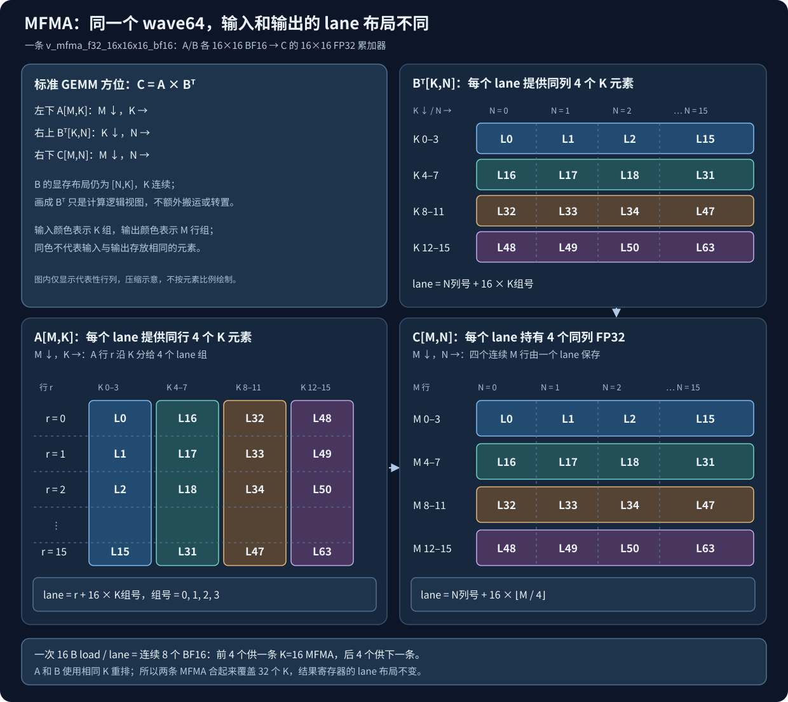
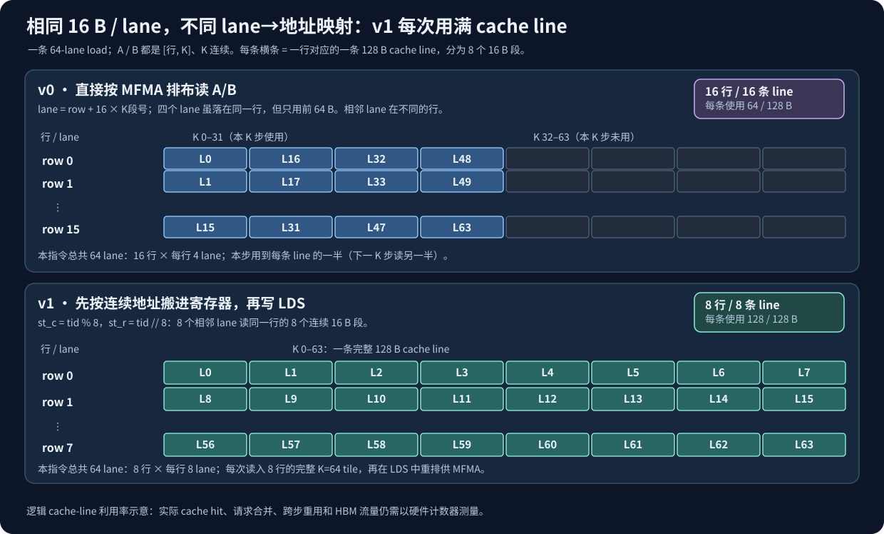
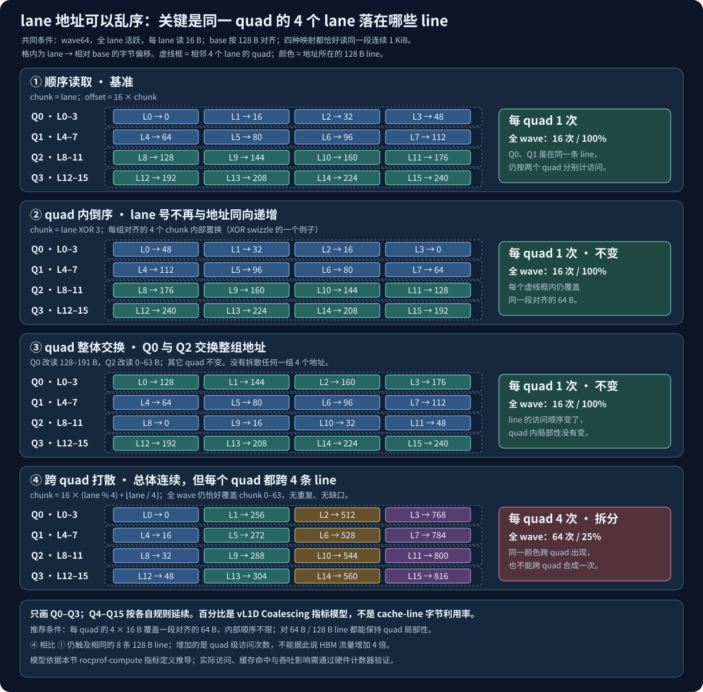
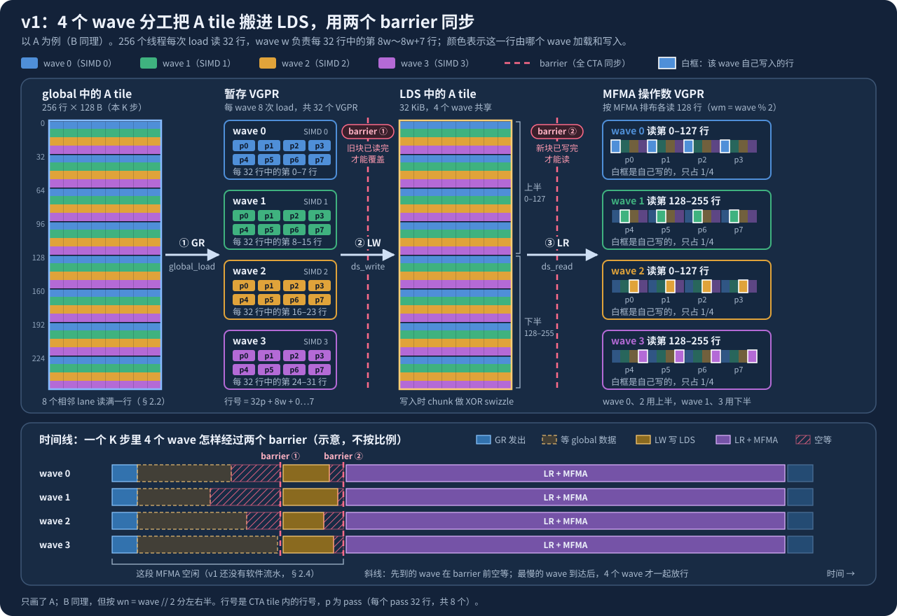
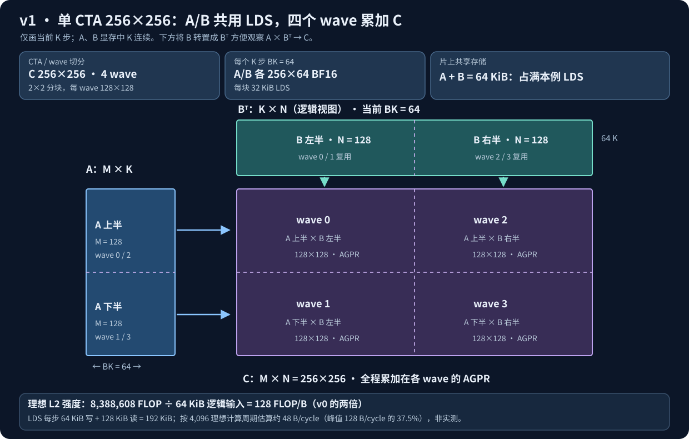
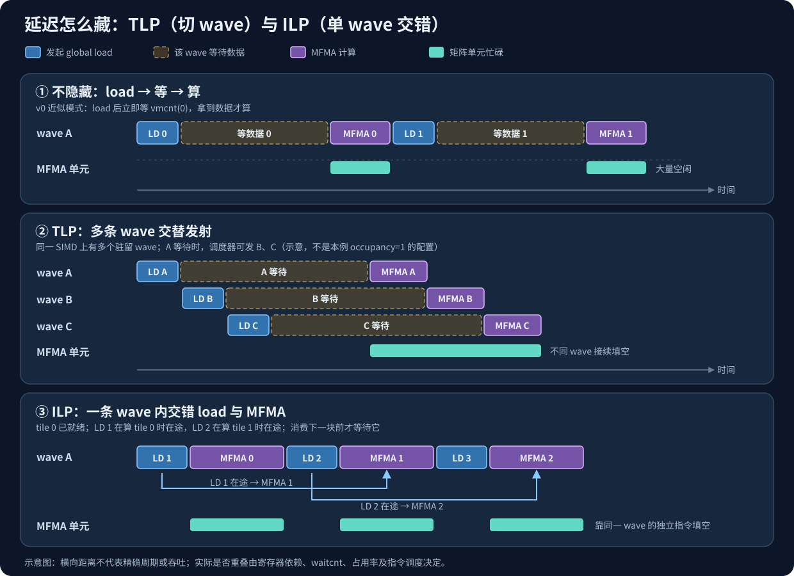
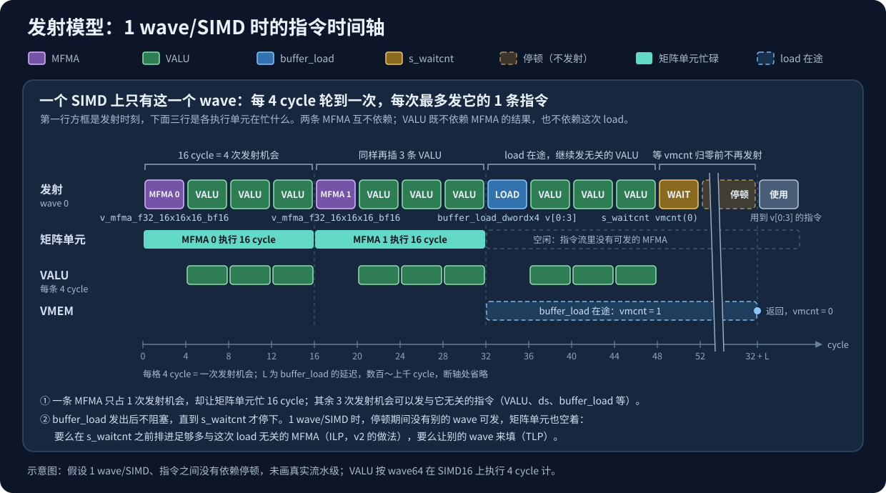
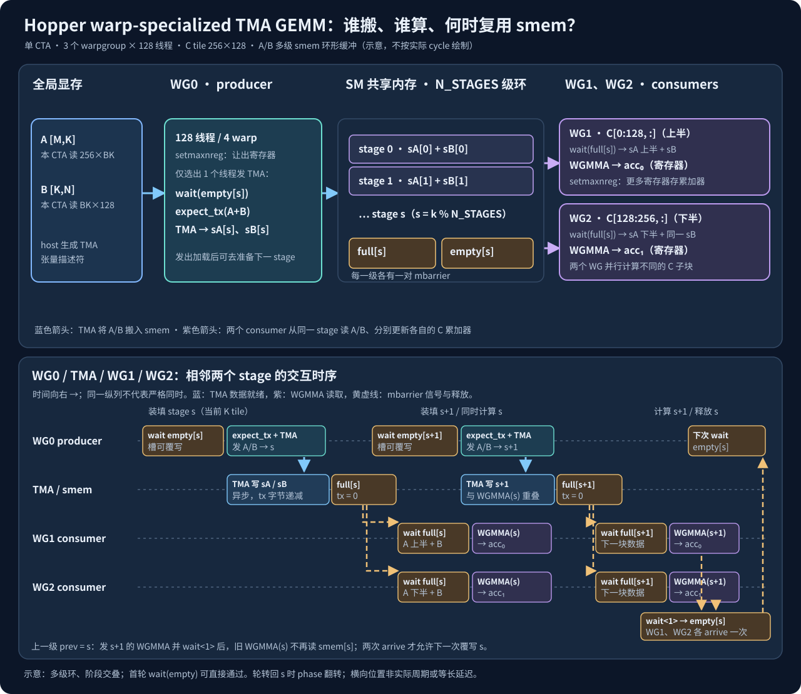
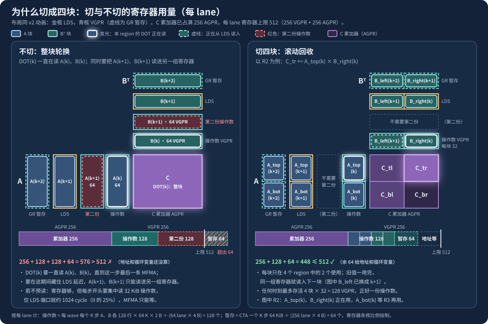

# CDNA3 (gfx942) BF16 GEMM：用 FlyDSL 从 v0 写到 v2

参考：

- [FlyDSL kernel tuning guide](https://github.com/ROCm/FlyDSL/blob/main/docs/kernel_tuning_guide.md)
- [gfx950-gluon-tutorials / gfx942 / intra_wave](https://github.com/ROCm/gfx950-gluon-tutorials/tree/main/kernels/gemm/gfx942/intra_wave)：v2 的设计来源

问题：`C[M,N] (fp32) = A[M,K] (bf16) · B[N,K]^T (bf16)`，A、B 都是 K 连续，`M=8192, N=9728, K=8192`。
v1/v2 的 `M/256 × N/256 = 32 × 38 = 1216 = 4 × 304` 个 CTA，恰为按 MI300X 的 304 CU 计的整数倍；输入尺寸都能整除各版本的 tile，因此这里不处理尾块。CTA 数是网格大小，**不保证硬件将它们平均分到每个 CU**。

| 文件 | 内容 |
|---|---|
| [v0.py](v0.py) | 1 wave/CTA，直接从显存读到寄存器做 MFMA |
| [v1.py](v1.py) | 4 wave/CTA，A/B 经 LDS 共享，XOR swizzle |
| [v2.py](v2.py) | v1 + 单 wave 软件流水（4 region、寄存器预取、`rocdl.sched_*` 调度提示） |
| [bench.py](bench.py) | 正确性 + 计时（含 `torch.matmul` 对照） |
| [slides/](slides/) | 培训 PPT：`make_figs.py` 画图，`make_ppt.py` 生成 `CDNA3_GEMM_FlyDSL.pptx`，`measure.sh` 采数据 |
| [slides/CDNA3_GEMM_README.pptx](slides/CDNA3_GEMM_README.pptx) | 本文的 21 页精简演示版；可用 [slides/make_readme_ppt.py](slides/make_readme_ppt.py) 重建（依赖见 [slides/requirements-readme-ppt.txt](slides/requirements-readme-ppt.txt)） |

```bash
python3 bench.py                    # 所有版本：正确性 + TFLOPS
python3 bench.py v1 v2              # 指定版本
```

---

## 读前须知（给有 NVIDIA 经验的读者）

本文假设你熟悉 CUDA 上的 GEMM 优化（tiling、smem、swizzle、软件流水）。AMD 的硬件概念不集中讲，而是在 v0 → v1 → v2 里第一次用到时引入：

文中 MI300X/H100 的峰值和规格用于建立硬件模型；性能表来自仓库保存的特定形状测量，不能直接当作其他设备、频率或矩阵形状的保证。

- 每个版本开头的 `x.0` 小节只讲这一版需要的硬件知识。
- **NVIDIA 对照** 框把它和你熟悉的概念对上：哪些一样、哪些不一样、为什么。
- 完整的规格对照见[附录 A](#附录-acdna3-与-hopper-完整对照)，常见误区速查见[附录 B](#附录-bnvidia-经验在-cdna3-上的常见误区)。

**术语映射**

| NVIDIA | AMD（CDNA3） | 首次出现 |
|---|---|---|
| SM | CU（Compute Unit），每 CU 4 个 SIMD | §1.0 |
| warp32 | wave64 | §1.0 |
| thread block | workgroup（本文仍叫 CTA） | §1.0 |
| 寄存器 | VGPR（向量）、AGPR（累加器）、SGPR（标量） | §1.0 |
| CuTe layout / CuTe DSL | FlyDSL layout（`make_ordered_layout` 等） | §1.1 |
| `mma.sync` / `wgmma` | MFMA（`v_mfma_*`） | §1.2 |
| SASS（`cuobjdump -sass`） | gfx942 ISA（`FLYDSL_DEBUG_DUMP_ASM=1`） | §1.4 |
| Nsight Systems / Compute | `rocprofv3`（kernel trace、PMC 计数器、ATT 指令级 trace） | §1.4 |
| shared memory | LDS（Local Data Share） | §2.0 |
| `__syncthreads()` | `s_barrier` | §2.0 |
| 全芯片统一的 L2 | XCD：8 个芯粒，各有独立 L2；其后是 256 MB MALL | §2.0 |

**路线图**

| 版本 | 优化 | 引入的 AMD 硬件概念 | 对应的 NVIDIA 经验 |
|---|---|---|---|
| v0 | 每 wave 算 128×128，寄存器复用 | CU / SIMD / wave64、MFMA 操作数排布、VGPR / AGPR 与 occupancy、`s_waitcnt` | `mma.sync` fragment、寄存器与 occupancy、SASS 依赖屏障 |
| v1 | LDS 共享 + XOR swizzle | LDS 容量与 bank、没有宽的异步拷贝、`s_barrier`、XCD 与 L2 | smem tiling、XOR swizzle、`__syncthreads` |
| v2 | 单 wave 软件流水 | 发射模型、ILP、`rocdl.sched_*`；Hopper 方案为什么搬不过来 | 多级流水、warp specialization、TMA / WGMMA |

---

## 1. v0：最直观的实现

把任务切成 CTA 交给各 CU：每个 CTA 只有 1 个 wave，算 C 的 `[BM, BN]` 块，直接从显存读入寄存器，然后做 MFMA。SIMD 之间不协作。

### 1.0 硬件：CU、wave64 与寄存器

- **CU 与 SIMD**：MI300X 有 8 个 XCD × 38 = 304 个 CU。每个 CU 有 4 个 SIMD，每个 wave（64 lane）固定在一个 SIMD 上执行。一个 CTA 只会在 1 个 CU 上运行；4 wave/CTA 时正好每个 SIMD 一个 wave。
- **矩阵算力**：每个 SIMD 有一个 Matrix Core，BF16 512 FLOP/cycle。`v_mfma_f32_16x16x16_bf16` 一条 8192 FLOP，占 16 cycle。整卡峰值 304 × 4 × 512 FLOP × 2.1 GHz = **1307 TFLOPS**。
- **寄存器**：每个 lane 最多 512 个 32 位寄存器，分成 256 VGPR + 256 AGPR。AGPR 主要放 MFMA 累加器（gfx90a 起 MFMA 可以直接读写 AGPR）。另有每 wave 共享的 SGPR（≤ 102 个）放标量。每个 SIMD 的 VGPR+AGPR 共 128 KB，所以 wave 用的寄存器越多，一个 SIMD 能同时驻留的 wave 越少：用满 512 时只能驻留 1 个。

> **NVIDIA 对照**
>
> - CU ≈ SM，SIMD ≈ SM 子分区（各有一个矩阵单元）。但单个 CU 的矩阵算力（2048 FLOP/cycle）只有 H100 SM（4096）的一半，MI300X 靠 304 个 CU（H100 是 132 个 SM）取胜。
> - wave64 的 lane 数是 warp 的 2 倍，所有“哪个 lane 拿哪几个元素”的推导都要按 64 重做。
> - 每 lane 寄存器上限是 NVIDIA 的约 2 倍（512 vs 255），而且累加器有独立的 AGPR 文件。代价是寄存器数在编译期固定，没有 `setmaxnreg`。
> - 标量值（循环变量、基址）放 SGPR、由 SALU 执行，作用类似 NVIDIA 的 uniform datapath，但更显式：ISA 里 `s_` 开头的就是标量指令。

### 1.1 FlyDSL 基本结构

```python
A = fx.make_view(fx.get_iter(A), fx.make_ordered_layout((8, K//8, 16, BM//16, grid_m), 0))
A = A[None, None, None, None, bid_m]                 # None = 保留该维，其余维取定值
row, kg = tid % 16, tid // 16
for k, acc in range(fx.Index(0), fx.Index(K//32), fx.Index(1), init=acc_init):   # 运行时 scf.for
    kk = fx.Int32(k) * 4 + kg                        # 循环变量是 index 类型，tid 是 Int32
    a_tile = [A[None, kk, row, i].load().bitcast(fx.Int16) for i in range_constexpr(NI)]   # 16 B load
    ...
    results = yield acc                               # 累加器作为 loop-carried 值
```

- `make_ordered_layout(shape, 0)`：第 0 维最连续。把 `A[M, K]` 看成 `(8, K/8, 16, BM/16, grid_m)` 的 5 维张量，切片和下标就直接对应“哪个 lane 读哪 16 字节”，不需要手写地址计算。
- `range_constexpr` 是编译期展开；`range(fx.Index(...), init=...)` 是运行时循环。边界必须是 DSL 类型，写成 Python int 会被展开。

> **NVIDIA 对照**：思路和 CuTe 的 layout 代数相同，用 shape/stride 描述张量，用切片把“线程 → 数据”的映射写出来；`None` 对应 CuTe 的 `_`，`range_constexpr` 对应 CuTe DSL 的同名函数。

### 1.2 MFMA 操作数排布

`v_mfma_f32_16x16x16_bf16`：lane `l` 提供 A 第 `l%16` 行、K 组 `l//16` 的 4 个元素，B 同理；结果 lane `l` 持有 C 的 `rows 4*(l//16)+0..3, col l%16`。

技巧：每个 lane 一次 load **8 个连续 K（16 B，`global_load_dwordx4` / `ds_read_b128`）**，前 4 个和后 4 个分别喂两条 MFMA。A、B 用同样的 K 排列，`Σk A·B` 不变。所以一个 wave 每步覆盖 32 个 K，所有 load 都是 16 B 宽。

**单条 MFMA 的 lane 排布**：左侧彩色 K 组表示 A/B 各 lane 提供的 4 个 BF16；右侧彩色 M 组表示每 lane 持有的同列 4 个 FP32 累加值。图中展示代表性行/列，其余按图内公式映射全部 64 个 lane。



[单独查看 MFMA lane 排布（SVG）](slides/figs/mfma_lane_mapping.svg)

**16 B load 的排布与访存合并**：把两条 MFMA 的 K 拼起来，一次 `global_load_dwordx4` 覆盖 16 行 × 32 K。A 在显存里按行存放，K 连续，行与行之间相隔 `K × 2 B = 16 KB`：



[单独查看 v0/v1 cache-line 利用对比（SVG）](slides/figs/mfma_coalescing.svg)

**问题：按 MFMA 排布直接从外存读，访存合并效率低。**MFMA 规定了每个 lane 拿哪些元素：lane `l` 提供 A 的第 `l%16` 行。所以直接按这个排布从显存读时，一条 load 的 64 个 lane 必然分散在 16 行，每行只有 `{Lr, Lr+16, Lr+32, Lr+48}` 这 4 个 lane，合起来读 64 B，只占一条 128 B cache line 的一半，另一半要靠下一条指令再读。数据可能命中 L1/L2，HBM 流量不一定翻倍，但每条指令涉及的 cache line 是读满时的两倍（16 条 vs 8 条）；按硬件实际的合并单位（quad，见下）计算，访问次数更是 4 倍（64 次 vs 16 次）。图中比较的是**单次指令的逻辑 cache-line 利用率**，跨 K 步的缓存复用和实际 HBM 流量不能直接据此推算。

**合并的单位是 quad，不要求 lane 号与地址同向递增**：CDNA3 把一条访存指令的 64 个 lane 按 quad（相邻 4 个 lane：lane 4i～4i+3）交给地址处理单元，每个 quad 内落在同一条 cache line 的地址合成 1 次访问，quad 之间不再合并。依据是 rocprof-compute 的 vL1D Coalescing 指标：`TA_TOTAL_WAVEFRONTS × 64 × 100 / (TCP_TOTAL_ACCESSES × 4)`，取值 25%～100%，即每条指令理想 16 次访问（每 quad 1 次），最差 64 次（每 lane 1 次）。因此：

| lane 与地址的对应关系 | 影响 |
|---|---|
| quad 内部任意置换（倒序、乱序），4 个地址仍在同一条 line 内 | 无影响，仍是 1 次访问 |
| quad 之间整体互换（例如 quad 0 读第 5 条 line，quad 1 读第 0 条） | 无影响，访问次数不变 |
| 一个 quad 的 4 个 lane 落到不同的 line，即使整条指令合起来仍是一段连续的 1 KiB | 这个 quad 要拆成多次访问，最坏每 lane 1 次 |

下图对比四种 lane→地址映射：它们都读取同一段连续的 1 KiB，但只有最后一种打散了 quad 内的 line 局部性。虚线框表示 quad，颜色表示地址所在的 128 B line；访问次数按本节的指标模型估计。



[单独查看 quad 合并与地址置换（SVG）](slides/figs/quad_coalescing.svg)

对 16 B 的 load，最稳妥的条件是**每个 quad 的 4 个 lane 合起来覆盖一段对齐的 64 B**，顺序不限。这样无论 L1 cache line 是 64 B（rocprof-compute 文档的说法）还是 128 B（本文的讨论口径），结论都成立。多拆出来的访问大多会命中 L1，HBM 流量通常不变；增加的是地址处理（TA）和 L1 tag 查找的次数，访存指令的吞吐随之下降。

本例中：

- v0 按 MFMA 排布直接读：一个 quad 的 4 个 lane 落在 4 行，每个 quad 要 4 次访问，整条指令 64 次，合并率 25%。
- v1 搬运时 `lane = 8·row + chunk`（§2.2）：每个 quad 读同一行的 4 个相邻 chunk，每个 quad 1 次访问。
- 在 global 地址一侧对 chunk 做 XOR 置换（CDNA4 用 global→LDS 直通时只能这样做 swizzle，§3.0）：`chunk ^ x` 把一组对齐的 4 个 chunk 映射成另一组对齐的 4 个 chunk，quad 仍在同一段 64 B 内，不影响合并。

这个模型是从指标定义推出来的；自己的访问模式可以用 `rocprofv3 --pmc TA_TOTAL_WAVEFRONTS_sum TCP_TOTAL_ACCESSES_sum` 实测合并率。

**通用的解决办法**是在“合并读取需要的连续排布”和“MFMA 需要的 lane 排布”之间做一次重排，区别在于重排发生在哪里：

| 办法 | 做法 | 代价与适用场景 |
|---|---|---|
| 预重排（preshuffle） | 事先在显存里把数据按 MFMA 的 lane 顺序排好，一个 wave 的 64 个 lane 正好读连续的 1 KiB | 运行时没有额外开销；只适合提前已知的数据（如推理权重），或让上游 kernel 直接按这个布局写出。布局与 MFMA 形状和 tile 绑定；数据直接进寄存器时，wave 之间也不再共享 |
| 经 LDS 重排（v1 的做法） | 按连续地址合并读进寄存器（每行 8 个相邻 lane 读满 128 B，§2.2），`ds_write` 写入 LDS，再按 MFMA 排布 `ds_read` 读出 | 适用于任意输入，还能让多个 wave 共享同一份数据；代价是 LDS 容量、`ds_write`/`ds_read` 带宽、barrier 和暂存寄存器（§3.6、§3.8）。CDNA4 可用 16 B 的 global→LDS 直通省掉暂存寄存器（§3.0） |
| 寄存器内跨 lane 交换 | 合并读入后，用 DPP、`ds_bpermute` 等在 lane 之间搬运数据 | 不占 LDS 容量；但每条指令只搬 4 B，16 B 要 4 条，开销大，只适合少量数据 |
| 调整 K 的排列 | `Σk` 与顺序无关，A、B 用同样的 K 排列，让每个 lane 读连续的 16 B | 没有额外开销，v0 已经在用；但每行最多 4 个 lane，只能做到半条 line，不能单独解决问题 |

v1 选择经 LDS 重排：它本来就要用 LDS 让 4 个 wave 共享 A、B，顺便把合并问题一起解决了。

> **NVIDIA 对照**
>
> - 相当于 `mma.sync.m16n8k16` 的 fragment 排布，只是一条指令覆盖 16×16×16、由 64 个 lane 一起提供操作数。NVIDIA 上常用 `ldmatrix` 把 smem 装成 fragment；CDNA3 没有 `ldmatrix`，直接按上面的排布用 16 B 的 load 读。
> - 访存合并：NVIDIA 按整个 warp 统计用到的 32 B sector 数，warp 内任意置换都不影响合并；CDNA3 的合并单位只有 4 个 lane，跨 quad 打乱地址是有代价的。

### 1.3 优化原理：寄存器复用

一个 wave 算 `BM×BN`，每个 K 读 `BM+BN` 个元素、做 `2·BM·BN` 次 FLOP：寄存器层的算术强度 `I = BM·BN/(BM+BN)` flop/B（bf16）。

| wave tile | I (flop/B) | 累加器 / lane | 结果 | 时间 (us) | TFLOPS |
|---|---|---|---|---|---|
| 64×64 | 32 | 64 | | 8051 | 162 |
| 128×128 | 64 | 256（AGPR 用满） | A/B 各 32 VGPR | 3863 | **338** |
| 128×256 | 85 | 512 | spill；不在统一基准记录中 | | ~90（单独试验） |

强度从 32 翻到 64，性能也约翻倍（2.08×），说明 v0 对数据搬运很敏感。128×256 的强度虽然更高，但累加器放不下，spill 到 scratch（显存）后反而慢到约 90 TFLOPS；这个配置在 [v0.py](v0.py) 的独立测试入口中，未列入统一的 [基准记录](slides/data/bench.txt)。

在不 spill 的前提下把 BM、BN 加到最大（128×128）。副作用是 occupancy 降到 1 wave/SIMD，没法靠 wave 切换（TLP）来掩盖延迟。

> **NVIDIA 对照**：在 NVIDIA 上，一个 warp 算 128×128 需要每线程 512 个 fp32 累加寄存器，超过 255 的上限，所以通常由多个 warp（Hopper 上是一个 warpgroup）分担。CDNA3 的 wave64 + AGPR 让一个 wave 就能扛住 128×128。occupancy = 1 在这里是常态，和 NVIDIA 上高性能 GEMM 的思路一致：用寄存器换复用，延迟靠 ILP 而不是靠切 warp。


### 1.4 观察硬件行为

```bash
FLYDSL_DEBUG_DUMP_ASM=1 FLYDSL_DUMP_IR=1 FLYDSL_DUMP_DIR=./dumps python3 v0.py   # IR + 最终 ISA
FLYDSL_DEBUG_ENABLE_DEBUG_INFO=1 rocprofv3 -i trace.yaml -- python3 v0.py       # ATT thread trace
rocprofv3 --stats --kernel-trace -f csv -- python3 v0.py                         # 基本信息
```

- ISA：每步 `global_load_dwordx4` 之后紧跟 `s_waitcnt vmcnt(0)` 才开始 MFMA，访存和计算串行。
  - `s_waitcnt`：每个 wave 有按发射顺序计数的计数器，`vmcnt` 数在途的显存访问，`lgkmcnt` 数在途的 LDS / 标量访问。`vmcnt(N)` 表示“等到在途的只剩 N 条”，也就是等最老的那些完成；由编译器根据数据依赖插入。`vmcnt(0)` 就是全部等完。
- ATT `occupancy.json`：每个 CU 的 4 个 wave（每 SIMD 一个）在开始时同时上线、到结束才下线，中间没有新 wave 可以切换。
- 问题：同一 CU 的 4 个 wave 各读各的 A、B 行，没有共享。

> **NVIDIA 对照**
>
> - ISA dump ≈ `cuobjdump -sass`；`rocprofv3 --pmc` ≈ Nsight Compute 的硬件计数器；ATT 能看到每条指令的发射时刻和 stall，Nsight 里最接近的是 Source 页的 warp stall 采样，但 ATT 是完整 trace 而不是采样。
> - `s_waitcnt` 对应 SASS 控制位里的依赖屏障（SB0~5）。区别是 AMD 只能“等最老的若干条”，不能指定等哪一条，所以**发射顺序决定了流水能有多深**（§3.7）。

---

## 2. v1：引入 LDS

CDNA3 的 4 个 SIMD 共享一个 LDS，所以 4 wave/CTA 可以通过 LDS + barrier 协作加载 A、B，再各自从 LDS 读取复用。

**引入 LDS 的好处**（与 v0 每个 wave 直接从外存读相比）：

| 好处 | v0：每个 wave 直接从外存读 | v1：4 个 wave 经 LDS 协作 |
|---|---|---|
| **去掉 wave 间的重复读取** | 4 个 wave 若合起来算一个 256×256 区域，A、B 的每一行都要被两个 wave 各读一次 | 每一行只由一个 wave 读一次：CTA 每 K 步从 L2 读 64 KiB，而不是 128 KiB；L2 层强度从 64 升到 128 FLOP/B |
| **外存访问合并更好** | 只能按 MFMA 排布读，每行只有 4 个 lane，一条 load 涉及 16 条 cache line、每条只用一半 | 搬运时按连续地址读，8 个相邻 lane 读满一行，一条 load 正好是 8 条完整的 cache line（§1.2） |
| **global load 条数减半** | 每个 wave 每 K 步 32 条 `global_load_dwordx4` | 每个 wave 只需 16 条；操作数改由 32 条 `ds_read_b128` 提供，延迟从数百～上千 cycle 降到约百 cycle |
| **复用不再受单个 wave 的寄存器限制** | 想提高强度只能加大 wave tile，128×256 时累加器就放不下了（§1.3） | 每个 wave 的累加器仍是 128×128（256 个），CTA tile 扩大到 256×256，强度翻倍 |
| **多了一级缓冲** | 数据只能放在寄存器里 | LDS 成为外存和寄存器之间的一级缓冲，v2 的软件流水就建立在它上面（§3） |

代价是每个 K 步需要两个 barrier，LDS 只有 64 KB（§3.2），`ds_write` / `ds_read` 要占用 LDS 端口，搬运还要经过暂存寄存器（§3.6、§3.8）。实测 L2 之外的读取从 5.59 GB 降到 1.24 GB，性能从 338 TFLOPS 提升到 440 TFLOPS（§2.4）。

下图以 A 为例：4 个 wave 各加载并写入 1/4 的行（每 32 行中各负责 8 行），但计算时每个 wave 要读其中一半（128 行），其中 3/4 是别的 wave 写的。所以写 LDS 之前要用 barrier 确认所有 wave 都读完了上一块，写完之后再用 barrier 确认这一块对所有 wave 都可见。



[单独查看 4 个 wave 协作加载与 barrier 同步（SVG）](slides/figs/v1_lds_cooperation.svg)

### 2.0 硬件：LDS、barrier 与缓存层次

- **LDS**：每 CU 64 KB，4 个 SIMD 共享。32 bank × 4 B，带宽 128 B/clk。
- **搬运路径**：CDNA3 的 global→LDS 直通只有 4 B/lane（`buffer_load_dword ... lds`），太窄。实用的路径是 global → VGPR（`global_load_dwordx4`）→ `ds_write_b128` → LDS，每个字节都要经过寄存器。
- **同步**：本例 CTA 内用 `s_barrier`，所有 wave 一起到达才放行。等本 wave 的 LDS 读写完成用 `s_waitcnt lgkmcnt(N)`。
- **缓存**：L1 32 KB/CU；L2 4 MB/XCD，8 个 XCD 之间不共享；其后是 256 MB MALL（Infinity Cache）和 HBM（MI300X 5.3 TB/s）。CTA 落在哪个 XCD 会影响 L2 复用，具体分配需要测量验证。

> **NVIDIA 对照**
>
> - LDS ≈ smem，但只有 H100（228 KB）的约 1/4。NVIDIA 上常见的 3~7 级 smem 环形缓冲在这里放不下（§3.2）。
> - 没有 `cp.async` / TMA：搬运要占 VGPR 和发射槽，写法更像 Ampere 之前的 `ld.global` → 寄存器 → `st.shared`。
> - `s_barrier` ≈ `__syncthreads()`；本例没有 Hopper 那种带事务字节计数的 mbarrier 来管理多级缓冲。
> - bank 结构相同（32 × 4 B），CUTLASS 的 XOR swizzle 思路可以直接用。
> - L2 不是全芯片统一的：两个 CTA 读同一块数据，只有落在同一个 XCD 上才能在 L2 命中（§5）。

### 2.1 切分



[单独查看 v1 tile 分工图（SVG）](slides/figs/v1_tiling.svg)。图中 128 FLOP/B 按 **每 K 步从 L2 读取 A、B 各一次**的逻辑数据量计算；48 B/cycle 按理想矩阵算力所需的 4,096 周期摊算，均非实测。代码中 `wave = tid // 64`、`wm = wave % 2`、`wn = wave // 2`，因此 A 上半被 wave 0/2 复用，B 左半被 wave 0/1 复用。

| 数据 | 尺寸 | 放在哪 | 每 lane 寄存器 |
|---|---|---|---|
| C 累加器 | 每 wave 128×128 fp32 | AGPR，整个 K 循环常驻 | 256 |
| A、B tile（当前 K 步） | 各 256×64 bf16 = 32 KB | LDS（共 64 KB，4 个 wave 共享） | — |
| 搬运暂存（global → LDS 中转） | A、B 各 256×64，由 256 个线程分担 | VGPR | A、B 各 8 × 16 B = 各 32 |
| MFMA 操作数 | 每 wave 每次取 32 个 K：A 128×32、B 128×32，每个 K 步取 2 次 | VGPR | A、B 各 8 × 16 B = 各 32 |

### 2.2 每个 K 步的三段

```python
st_c, st_r = tid % 8, tid // 8  # staging：8 个线程读同一行
a_st = [A[None, st_c, kt, st_r, p].load() for p in range_constexpr(BM // 32)]   # ① global -> 暂存寄存器
gpu.barrier()                                                                   # 所有 wave 读完上一块
for p in range_constexpr(BM // 32):
    lds_chunk(lds_a, st_c, p * 32 + st_r).store(a_st[p])                         # ② 暂存寄存器 -> LDS
# B 的 b_st、lds_b 同理（省略）
gpu.barrier()                                                                   # 本块对所有 wave 可见
a_tile = [lds_chunk(lds_a, kg + s * 4, wm * WM + i * 16 + row).load()
          for i in range_constexpr(NI)]                                         # ③ LDS -> 寄存器 -> MFMA
```

- 以上是省略 B 搬运和 MFMA 循环的片段，`lds_chunk` 采用 [v1.py](v1.py) 中的手写 XOR 或 FlyDSL composed layout 实现，并非可以直接单独运行的完整 kernel。
- **合并访存**：`st_c = tid % 8, st_r = tid // 8`，8 个相邻线程读一行的 128 B，一个 wave 一条指令读 8 行 = 1024 B 连续。
- **申请 LDS**：`@fx.struct` 声明 `fx.Array[fx.BFloat16, n, 16]`，`fx.SharedAllocator().allocate(...)`，再 `.view(layout)` 得到可切片的 LDS 张量。
- **FlyDSL 内置 swizzle**：手写 XOR 是最直接的思路，但不一定最自然。FlyDSL 也提供了一层布局表达：

```python
swz = fx.static(fx.SwizzleType.get(3, 3, 3))
layout = fx.make_composed_layout(swz, fx.make_ordered_layout((8, 8, BM), 0))

# 逻辑坐标 (chunk, row) -> 物理偏移
ptr = fx.add_offset(lds.a.ptr, fx.crd2idx((0, c, r), layout))
view = fx.make_view(ptr, fx.make_layout(8, 1))
```

这和手工写 `chunk ^ (row % 8)` 是同一个映射：把 `row % 8` 这一位组拿去 XOR 到 `chunk` 的低位，保证同一拍访问的 8 行不再落到同一组 bank。FlyDSL 不直接支持对 `composed layout` 做向量 `load/store`（这个版本里会报 `MemRefLoadVecOp: MemRefType with ComposedLayout is not supported`），所以通常做法是：让它只算地址，拿到 `crd2idx` 的 swizzled offset，再把这 8 个元素包成一个普通的 8 元素 view，继续做 `load()/store()`。这正是 `v1.py` 中 `SWIZZLE="fly"` 的实现方式：相同语义，保留手写版可读性与更低的 VGPR 成本。

### 2.3 LDS 硬件结构与 bank conflict

LDS 由 CU 的 4 个 SIMD 共享，包含 32 个 4 B bank；读写及原子请求经过仲裁和地址 crossbar 访问 bank，读数据再经 crossbar 返回。不同地址同时落到同一 bank 时需要分批服务。结构见 [AMD 官方 LDS 文档](https://rocm.docs.amd.com/projects/rocprofiler-compute/en/latest/conceptual/cdna/pipeline-descriptions.html#local-data-share-lds)。

```text
SIMD / wave → 请求仲裁 → 地址 crossbar → 32 bank（64 KB/CU）→ 读数据 crossbar → SIMD
```

**与 Hopper smem 的思路一样**：本例一行 64 个 bf16 = 128 B，恰好跨 32 个 bank。MFMA 排布使 `ds_read_b128` 的一组 8 个 lane 读 **8 行的同一个 16 B chunk**；不 swizzle 时，这些行对应相同的 4-bank 组，访问被串行化。把物理 chunk 改成 `chunk ^ (row % 8)`，就将这 8 次读分散到不同 bank 组；写同一行时仍是 chunk 的置换，无需 padding。本例测得 `SQ_LDS_BANK_CONFLICT = 0`。

区别在**实现位置**：Hopper 上可通过 CuTe/CUTLASS 布局表示 XOR，TMA 写 smem 时也可选硬件 swizzle；这里的 CDNA3 kernel 由 FlyDSL 布局或手写 XOR 计算 LDS 地址（§2.2），不是 LDS 硬件自动替普通访存做 swizzle。

### 2.4 v1 的问题

沿用 §1.3 的指标对比；v1 的 CTA tile 是 256×256，由 4 个 wave 各算 128×128，因此寄存器层强度和每 lane 累加器数量仍按 **wave tile** 计算。时间和吞吐取自同一次 8192×9728×8192 BF16 GEMM 测量。

| wave tile | I (flop/B) | 累加器 / lane | 结果 | 时间 (us) | TFLOPS |
|---|---|---|---|---|---|
| 64×64（v0） | 32 | 64 | | 8051 | 162 |
| 128×128（v0） | 64 | 256（AGPR 用满） | A/B 各 32 VGPR | 3863 | **338** |
| 128×256（v0） | 85 | 512 | spill；不在统一基准记录中 | | ~90（单独试验） |
| 128×128（v1；CTA 256×256） | 64 | 256（AGPR 用满） | A/B 经 LDS 跨 wave 共享 | 2965 | **440** |

此时还没有软件流水：每个 K 步严格串行，发 global load → 等 `vmcnt(0)` → barrier → 写 LDS → barrier → 读 LDS + MFMA。1 wave/SIMD 下没有别的 wave 填空档。v1 相比 v0 128×128 快约 1.30 倍；L2 之外的读取从 5.59 GB 降到 1.24 GB（约为原来的 22%），但 MFMA 大部分时间仍在等待访存。

**如何测 L2 之外的实际读取量**：在 MI300X 上用 `rocprofv3 --pmc` 收集 `TCC_EA0_RDREQ_sum` 和 `TCC_EA0_RDREQ_32B_sum`（本仓库的 [采集脚本](slides/measure.sh) 会自动完成，并把结果写入 [计数结果](slides/data/counters.txt)）。只跑 v1 可在 `kernels/gemm` 目录执行：

```bash
rocprofv3 --pmc TCC_EA0_RDREQ_sum TCC_EA0_RDREQ_32B_sum \
    --kernel-include-regex 'gemm_v' -d /tmp/v1-pmc -o pmc -f csv \
    -- python3 bench.py v1
```

在输出的 `*counter_collection.csv` 中按 `Dispatch_Id` 汇总每个计数器的 `Counter_Value`；每次 dispatch 的读取字节数为 `(TCC_EA0_RDREQ_sum - TCC_EA0_RDREQ_32B_sum) × 64 + TCC_EA0_RDREQ_32B_sum × 32`。多次 dispatch 取均值、除以 `1e9` 得 GB，得到上面的 1.24 GB（v0 128×128 同法得到 5.59 GB）。**口径是 L2/TCC 向外发出的读请求字节数，包含后续 MALL 命中，不能当作 HBM 物理读取字节数**；不要把它与源代码中 A/B 张量大小或 L2 命中率直接混用。

---

## 3. v2：重叠搬运和计算 —— 单 wave 软件流水

前两步为了最大数据复用、降低外存访问，把 occupancy 做到了 1，没有 TLP 可用了。这时只能用 **ILP**：在同一个指令流里并行发出彼此无关的 vmem / MFMA / ds / valu 指令。要做到这一点，需要软件流水。

**延迟怎么藏：TLP（切 wave）与 ILP**

一次 global load 要几百到上千 cycle 才回来，一条 MFMA 只有 16 cycle。要让 MFMA 单元一直有活干，等数据的这段时间必须有别的指令可发。办法有两种：



[单独查看 TLP/ILP 时间轴（SVG）](slides/figs/tlp_ilp.svg)

| | TLP（切 wave） | ILP（单 wave 内交错） |
|---|---|---|
| 谁来藏延迟 | 硬件调度器：一个 wave 卡住时发另一个 wave 的指令。<br>所有驻留 wave 的寄存器一直在寄存器堆里，<br>“切换”是零开销的逐拍选择，不是上下文切换 | 编译器 / 程序员：在需要等待之前，先发出与它无关的指令 |
| 代价 | - 每个 wave 都要一份寄存器，wave 越多每个 wave 的寄存器越少，tile 只能变小、复用变差; <br>- wave之间寄存器无法复用，都要从LDS/L2/外存读取，带宽压力增大；<br>- 同行wave寄存器副本增多，浪费寄存器 | - 要额外寄存器暂存在途的数据；<br> -指令顺序要精心安排（软件流水、`rocdl.sched_*`）; |
| 本例 | 128×128 tile 用满 512 个寄存器，每 SIMD 只能驻留 1 个 wave，**TLP 不可用** | v2 的做法（§3）：提前 2 个 K 步发 load，并把访存与 MFMA 交错 |

一句话：TLP 用“更多 wave”换延迟，ILP 用“更多寄存器 + 更好的指令顺序”换延迟。寄存器既要放大 tile 提高复用，又要支撑多个 wave 或在途数据，三者互相争抢；本教程选择把寄存器优先给大 tile，所以只能走 ILP。

设计完全仿照 [gfx942/intra_wave](https://github.com/ROCm/gfx950-gluon-tutorials/tree/main/kernels/gemm/gfx942/intra_wave)，代码从 v1 修改而来。

### 3.0 硬件：发射模型，以及 Hopper 的做法为什么搬不过来

**发射模型**

- 每个 CU 的 4 个 SIMD 轮流发射，每个 SIMD 每 4 cycle 轮到一次。一次可以从不同 wave 发出最多 5 条不同类型的指令（VALU、SALU、VMEM、LDS、分支等），但**同一个 wave 一次只能发 1 条**。
- 1 wave/SIMD 时，一个 wave 每 4 cycle 最多发 1 条指令。一条 MFMA 占 16 cycle，所以两条背靠背的 MFMA 之间最多插 3 条别的指令，所有搬运都要挤进这些空隙（§3.7）。
- MFMA 发出后在矩阵单元里执行，后面不相关的指令可以继续发，依赖由硬件互锁处理。所以“异步”靠的是同一指令流里的交错，而不是专门的异步指令。

下图把这三条画在同一条时间轴上：两条互不依赖的 MFMA 背靠背发出，每条的 16 cycle 里再插 3 条 VALU；随后发出 `buffer_load`，在 `s_waitcnt vmcnt(0)` 之前还能继续发不依赖这次 load 的 VALU，之后整个 wave 停下来等数据。



[单独查看发射时间轴（SVG）](slides/figs/issue_timeline.svg)

> **NVIDIA 对照**：Hopper 子分区调度器每 cycle 发 1 条，warp 多时靠切换 warp 藏延迟。CDNA3 上本例 1 wave/SIMD 没有其它 wave 可切换，主要靠 ILP 和 `rocdl.sched_*` 辅助编译器安排指令顺序。

**Hopper 的另一种组织方式：warp specialization**

同样是“让搬运和 MMA 重叠”，Hopper 的标准答案是 warp specialization：一个 producer warpgroup 用 TMA 把数据搬进多级 smem，两个 consumer warpgroup 用 WGMMA 直接从 smem 算，双方用 mbarrier 按 stage 握手，并用 `setmaxnreg` 把 producer 的寄存器让给 consumer。结构对应 CUTLASS 3.x 的 `KernelTmaWarpSpecializedCooperative`（单 CTA，不含 cluster / multicast）：



[单独查看 Hopper warp-specialized 示意图（SVG）](slides/figs/hopper_warp_specialized.svg)。上半部是角色和资源，下半部按 **WG0 / TMA-smem / WG1 / WG2** 四条泳道从左向右读：

- WG0 等 `empty[s]` 后发 A/B 的 TMA；当 smem 写完且 `full[s]` 的事务字节数归零，WG1/WG2 才可读同一个 stage，分别用 WGMMA 累加 C 的上下半块。此时 WG0 可以继续填 `s+1`，**搬运与计算跨 WG、跨 stage 重叠**。
- WG1/WG2 发出 `s+1` 的 WGMMA 并完成 `wgmma_wait<1>` 后，才能各自对上一级 `empty[prev]` arrive 一次（图中 `prev = s`）；两次都到齐，WG0 下次轮转到该槽才可覆写。环回时 phase 翻转。横轴是事件依赖示意，不是逐周期时序。

<details>
<summary>Hopper warp-specialized TMA GEMM 伪代码</summary>

```c++
// ============================================================
// Hopper Warp-Specialized TMA GEMM 伪代码
// A[M,K] * B[K,N] -> D[M,N]，BF16 输入，FP32 累加
// CTA = 3 个 warpgroup（384 线程）：WG0 = producer，WG1/WG2 = consumer
// CTA tile 256x128：两个 consumer WG 沿 M 各算 128x128（cooperative）
// smem：N_STAGES 级 A/B 环形缓冲（H100 每 SM 228 KB，常见 4~7 级）
// ============================================================

__global__ void hopper_ws_tma_gemm(const __grid_constant__ CUtensorMap descA,   // TMA 描述符由 host 创建，
                                   const __grid_constant__ CUtensorMap descB,   // 必须以 __grid_constant__ 传入
                                   ...) {
    // ---------- 关键点 1：线程角色划分 ----------
    int  wg_id       = threadIdx.x / 128;          // 0 = producer, 1..2 = consumer
    int  warp_in_wg  = (threadIdx.x / 32) % 4;
    bool is_producer = (wg_id == 0);

    // ---------- 关键点 2：smem 环形缓冲 + mbarrier ----------
    extern __shared__ char smem[];
    Tile* sA[N_STAGES], *sB[N_STAGES];             // 指向 smem 内的各级 buffer
    __shared__ uint64_t full_barrier[N_STAGES];    // mbarrier 必须放在 smem
    __shared__ uint64_t empty_barrier[N_STAGES];   // full：数据已到；empty：可被覆盖

    if (threadIdx.x == 0) {
        for (int i = 0; i < N_STAGES; i++) {
            mbarrier_init(full_barrier[i], 1);               // 1 次 arrive（producer）+ tx 字节计数
            mbarrier_init(empty_barrier[i], NUM_CONSUMER_WG); // 每个 consumer WG 1 次 arrive
        }
        fence_barrier_init();                       // 让 async proxy（TMA 单元）看到初始化结果
    }
    __syncthreads();

    // ---------- 关键点 3：寄存器重新分配（setmaxnreg） ----------
    // 以每线程 168 个寄存器启动（384 × 168 = 64512），再按角色重新分配：
    // 128 × 24 + 256 × 240 = 64512 ≤ 65536（每 SM 64K 个 32 位寄存器）
    if (is_producer) warpgroup_reg_dealloc<24>();
    else             warpgroup_reg_alloc<240>();

    // ============================================================
    // producer：整个 WG 只有 1 个线程发 TMA
    // ============================================================
    if (is_producer) {
        // elect_one_sync() 是“每个 warp 选 1 个线程”，所以还要限定 warp 0，
        // 否则 4 个 warp 各发一次 TMA、各 arrive 一次，full_barrier 计数就错了
        if (warp_in_wg == 0 && elect_one_sync()) {
            int stage = 0, phase = 1;               // producer 从 phase=1 开始：首轮 wait 直接通过（buffer 初始为空）
            for (int k_tile = 0; k_tile < num_k_tiles; k_tile++) {
                mbarrier_wait(empty_barrier[stage], phase);                       // 等 consumer 释放该级
                mbarrier_arrive_expect_tx(full_barrier[stage], BYTES_A + BYTES_B); // 声明将到达的字节数
                tma_load_2d(descA, sA[stage], {k_tile * BK, m0}, full_barrier[stage]); // 异步；数据写入 smem 后
                tma_load_2d(descB, sB[stage], {k_tile * BK, n0}, full_barrier[stage]); // 硬件按字节数递减 tx
                if (++stage == N_STAGES) { stage = 0; phase ^= 1; }
            }
        }
    }
    // ============================================================
    // consumer：2 个 WG，各自用 WGMMA 算 128x128
    // ============================================================
    else {
        float acc[128] = {0};                      // 累加器在寄存器：128x128 fp32 / 128 线程
        int m_off = (wg_id - 1) * 128;             // cooperative：沿 M 切半（ping-pong 则两个 WG 各算不同 tile）
        int stage = 0, phase = 0, prev = -1;
        for (int k_tile = 0; k_tile < num_k_tiles; k_tile++) {
            mbarrier_wait(full_barrier[stage], phase);   // producer 已 arrive 且 tx 归零 = TMA 数据已写入 smem

            // ---------- 关键点 4：WGMMA（异步，4 个 warp 共同发射） ----------
            warpgroup_arrive();                           // wgmma.fence：保证此前对累加器寄存器的读写有序
            wgmma_async(acc, sA[stage] + m_off, sB[stage]); // B 必须来自 smem；A 可来自 smem 或寄存器
            wgmma_commit_group();
            wgmma_wait<1>();                              // 只留本次在飞，上一级的 wgmma 已读完 smem
            if (prev >= 0 && threadIdx.x % 128 == 0)
                mbarrier_arrive(empty_barrier[prev]);     // 释放上一级给 producer
            prev = stage;
            if (++stage == N_STAGES) { stage = 0; phase ^= 1; }
        }
        wgmma_wait<0>();
        if (threadIdx.x % 128 == 0) mbarrier_arrive(empty_barrier[prev]);

        // ---------- 关键点 5：epilogue ----------
        store_accumulator(acc);   // 寄存器 -> smem -> TMA store，或直接 st.global
    }
}
```

</details>

**这些关键技术在 CDNA3 / CDNA4 上的情况**

| Hopper 技术 | 作用 | CDNA3（gfx942，MI300X/MI325X） | CDNA4（gfx950，MI350X/MI355X） | 本教程的替代做法 |
|---|---|---|---|---|
| **TMA**（张量描述符，单线程发起，硬件生成地址、越界填充、smem swizzle） | 搬运不占寄存器，几乎不占发射槽 | **无**。每个 lane 自己算地址；global→LDS 直通只有 4 B/lane（`buffer_load_dword ... lds`） | **无 TMA**。新增 16 B/lane 的 `global/buffer_load_lds_dwordx4`，数据不经 VGPR，但仍是每 lane 一条地址、用 `vmcnt` 计数；LDS 目标地址由 `M0` + lane 线性决定，swizzle 只能在 global 地址一侧做 | global → VGPR → `ds_write`（v1/v2）；buffer resource 的 `num_records` 越界读返回 0，部分代替 TMA 的边界处理；XOR swizzle 手算 |
| **mbarrier + 事务计数**（arrive / wait 分离、phase 翻转、TMA 完成自动递减） | 生产者与消费者按 stage 精确握手，不需要全 CTA 同步 | **无**。只有 `s_barrier`（CTA 内**所有** wave 一起）和每个 wave 自己的 `s_waitcnt vmcnt/lgkmcnt` | 同 CDNA3 | 用全 CTA `s_barrier` + 编译器插入的 `s_waitcnt`；自己用 LDS 标志位 + 轮询（`s_sleep`）可以模拟，但开销大 |
| **Warp specialization**（producer / consumer WG） | 搬运和计算由不同 warp 负责，靠 warp 调度器重叠 | 可以写，但**不划算**：没有部分 barrier；producer wave 要和某个 consumer 共用一个 SIMD 的发射槽和寄存器 | 同 CDNA3 | 单 wave 软件流水（v2，ILP）；或每 SIMD 2 个 wave 用 `s_barrier` + `s_setprio` 乒乓（§5 inter_wave） |
| **setmaxnreg**（运行时按 WG 调整寄存器数） | producer 让出寄存器给 consumer 放大累加器 | **无**。同一 kernel 所有 wave 的 VGPR/AGPR 数在编译期固定 | 同 CDNA3 | 1 wave/SIMD 下每 wave 512 个（256 VGPR + 256 AGPR）都给计算；如果再加一个 producer wave，每 wave 最多只剩一半，累加器 tile 就得减半 |
| **WGMMA**（异步、操作数直接读 smem、`commit/wait_group`） | 不用先把 A/B 搬进寄存器；MMA 在后台跑 | **无**。MFMA 操作数只能来自 VGPR/AGPR，每个 K 步都要先 `ds_read`；没有 `wait_group` | 同 CDNA3；MFMA 吞吐翻倍（`v_mfma_f32_16x16x32_bf16`），新增 `ds_read_b64_tr_b16`（读 LDS 时转置） | `ds_read` 与 MFMA 在同一指令流里穿插（`rocdl.sched_*`，§3.7） |
| **大 smem 多级流水** | 3~7 级环形缓冲藏住 HBM 延迟 | LDS 64 KB/CU，256×256×64 只能放 1 级 | LDS 160 KB/CU，可以 2 级 | 用寄存器当第二级 buffer（§3.2、§3.6） |
| **Thread Block Cluster / DSMEM / TMA multicast** | 相邻 CTA 共享一次 global 读 | **无** | **无** | 依赖 L2 / MALL 复用；XCD 感知的 CTA 重映射（§5） |
| **TMA store**（epilogue） | 寄存器 → smem → 一条指令批量写回 | **无** | **无** | 每个 lane 自己 `global_store` / `buffer_store` |

结论：

- **CDNA3** 上，搬运必须经过 VGPR，同步只有全 CTA `s_barrier` 和每 wave 的计数器，矩阵指令只能读寄存器。Hopper 那一套“TMA + mbarrier + WGMMA + setmaxnreg”撑起来的 warp specialization 一样都没有，所以 v2 走单 wave 软件流水，把搬运、`ds_read`、`ds_write` 都排进同一个指令流里和 MFMA 穿插。
- **CDNA4** 补上了 16 B 的 global→LDS 直通和 160 KB LDS，能力上接近 Ampere 的 `cp.async` + 多级 smem 流水（不占 VGPR、可以双缓冲），但仍没有 TMA、mbarrier、WGMMA、setmaxnreg、cluster，同步模型和 CDNA3 一样。

### 3.1 要藏哪些延迟

| 延迟来源 | 量级 | 藏法 |
|---|---|---|
| global load（L2/MALL/HBM） | 数百~上千 cycle | 提前 2 个 K 步发出（GR k+2） |
| 寄存器 → LDS | 等 global 数据到达 | 提前 1 个 K 步写入（LW k+1） |
| LDS → 寄存器 | ~100 cycle | 提前 1 个 region（~1024 cycle）读出（LR） |

### 3.2 为什么不是 LDS 双缓冲

- 256×256×64 一级就是 64 KB，LDS 正好放一级。
- 把 BK 降到 32 做双缓冲（8 KB × 8 = 64 KB）：每行只有 64 B，一条 `global_load_dwordx4` 要碰 16 条 cache line，TCP 处理时间加倍。参考实现实测 400 vs 476 TFLOPS，更慢。
- 结论：**保持 BK=64，用寄存器当第二级 buffer**，LDS 原地刷新。NVIDIA 上对应的做法是 TMA/cp.async + 多级 smem 环形缓冲，在 CDNA3 上做不到。

### 3.3 半 tile 切分与 4 个 region

A 沿 M 切成 `A_top / A_bot`，B 沿 N 切成 `B_left / B_right`，每个 16 KB，占一个 LDS slot（4 个 slot 正好 64 KB）。`(A 半, B 半)` 组成 C 的一个 128×128 象限；每个 wave 在每个象限各算 64×64。

**为什么切成四块**：LDS、MFMA 操作数寄存器和 GR 暂存都只放得下一个 K 步的一份数据。如果整块轮换，必须等所有 wave 读完当前块才能写下一块；想提前读下一步的操作数，又要第二份操作数寄存器（超出 256 VGPR）。因此要把 tile 切成能各自回收的小块，某块的旧值一用完就立即覆盖。A 切上 / 下、B 切左 / 右是同时满足下列约束的最粗切法：

- global load 仍读满 128 B 整行，`ds_write` 条数不变（沿 K 切做不到）；
- 每块只在 4 个 region 中的 2 个使用，用完后有时间重读，操作数寄存器峰值正好 128 VGPR（只切 A 时，B 在相邻 region 都要用，需要两份 B 操作数，寄存器超预算）；
- wave 不按象限分工（否则每个 region 只有一个 wave 在算），而是每个 wave 在每个象限各算 64×64，每个 region 4 个 wave 都有活干。

下图沿用动画的布局，对比同一时刻需要存活的寄存器。左：不切时，DOT(k) 还在读 A(k)、B(k)，下一步的操作数只能读进第二组寄存器，每 lane 共需 576 个，超过 512。右：切成四块后（以 R2 为例），旧块一用完就在原寄存器读入新块，最多存活 4 块，共 448 个。



[单独查看切与不切的寄存器对比（SVG）](slides/figs/split_registers.svg)

完整推导见[附录 C 推导 4](#推导-4切分维度与-wave-划分h3h4h8)；为什么必须切块，见[推导 3](#推导-3缓冲份数h3h4p1p2)。

**先看动画，再对照下面的表和 §3.4–3.5 的代码**：动画只播放稳态循环体（R0 → R1 → barrier X → R2 → R3 → barrier Y），不重复 prologue。每一步的操作同时开始、在 2 秒内完成，随后停顿 3 秒再进入下一步；底部进度条仅在这 2 秒内前进，并显示当前步骤（共 6 步，包含两个 barrier）。这些秒数只是演示节奏，**不是硬件执行延迟**。开头已预备好 A_top/B_left(k) 的 MFMA 操作数、A_bot/B_right(k) 的 LDS 数据以及 k+1 的 GR 暂存；结尾回到相同的存储分布，只把 k 整体推进一步。按典型 GEMM 布局，A 从左下 HBM 向右经 GR 暂存 VGPR、LDS、MFMA 操作数 VGPR；Bᵀ 从右上 HBM 向下经过同样四层。计算 `C_tl += A_top(k) × B_left(k)` 时，**A/B 留在操作数 VGPR 原位**，两条流动箭头表示 MFMA 从中读取；箭头抵达后 `C_tl` 加亮。R1–R3 依次点亮另外三个象限，**亮起后保持至本轮结束，下轮重新全暗**。这只是数据依赖示意，真实 MFMA 不会把操作数搬进 C，而是在 AGPR 中更新累加器。蓝色、金色、青色外框分别代表 HBM、LDS、VGPR（虚线青框是 GR 暂存）；空框表示本次取用，不代表 HBM 数据被删除。同一 region 的访存和 DOT 实际交错发射。



[单独打开动画（SVG）](slides/figs/v2_pipeline.svg)

一个 K 步 = 4 个 region，每个 region = 一个象限的 64 条 MFMA（约 1024 cycle），再穿插三种访存：

| region | DOT | LR（LDS→寄存器） | LW（寄存器→LDS） | GR（global→寄存器） |
|---|---|---|---|---|
| 0 | `C_tl = A_top·B_left` | `A_bot(k)` | `B_left(k+1)` | `B_left(k+2)` |
| 1 | `C_bl = A_bot·B_left` | `B_right(k)` | `A_top(k+1)` | `A_top(k+2)` |
| — | **barrier X** | | | |
| 2 | `C_tr = A_top·B_right` | `B_left(k+1)` | `A_bot(k+1)` | `A_bot(k+2)` |
| 3 | `C_br = A_bot·B_right` | `A_top(k+1)` | `B_right(k+1)` | `B_right(k+2)` |
| — | **barrier Y** | | | |

- LR 读的总是**下一个** region 要用的操作数，所以 LDS 延迟有一个 region 的时间来藏。
- 相邻 region 共享一个操作数：`b_left` 用于 R0、R1，`a_top` 用于 R0、R2，依此类推。
- 某个 slot 读完以后，过一个 region 就重写；重写以后，再过一个 region 才被读。所以**单级 LDS 足够**。
- 流水深度：同一块数据从 GR(k+2) 到下一步的 LW(k+2)，中间隔约一个 K 步的计算；LR 也比使用该操作数的 DOT 提前发出，中间穿插其他 region 的计算，以掩盖 LDS 延迟。这里的周期数是按矩阵单元理想吞吐估算，不是固定的访存延迟。

### 3.4 正确性：为什么每 K 步只要 2 个 barrier

LDS 是 4 个 wave 共享的：一个 wave 写的数据要被其它 wave 读，所以同一 slot 的读和写之间必须隔一个 barrier。逐个 slot 检查：

| slot | 上次读（WAR） | 写 | 下次读（RAW） | 隔开它们的 barrier |
|---|---|---|---|---|
| B_left | 上一 K 步 R2 | R0 | R2 | Y（上一步末尾） / X |
| A_top | 上一 K 步 R3 | R1 | R3 | Y / X |
| A_bot | R0 | R2 | 下一 K 步 R0 | X / Y |
| B_right | R1 | R3 | 下一 K 步 R1 | X / Y |

每一对读写都恰好跨过 X 或 Y。prologue 末尾还需要一个 barrier：prologue 里读了 `b_left(0)`、`a_top(0)`，要等它们读完，R0 才能重写 B_left。

`gpu.barrier()` 会先等本 wave 的 LDS 操作完成（`s_waitcnt lgkmcnt(0)`），再发 `s_barrier`。

### 3.5 代码结构

```python
def kstep(acc, a_top, b_left, g, kt2, last):          # last: 0 稳态 / 1 不再 GR / 2 不再 GR、LW
    g_bl, g_at, g_ab, g_br = g
    acc[0] = dot(acc[0], a_top, b_left)                # region 0
    a_bot = lr(lds_a, 1, wm)                           #   LR A_bot(k)
    lw(lds_b, 0, g_bl)                                 #   LW B_left(k+1)
    g_bl = gr(B, 0, kt2)                               #   GR B_left(k+2)
    interleave(8, 4, 4)
    acc[1] = dot(acc[1], a_bot, b_left)                # region 1 ...
    ...
    gpu.barrier()                                      # X
    ...                                                # region 2, 3
    gpu.barrier()                                      # Y
    return acc, a_top, b_left, [g_bl, g_at, g_ab, g_br]

# prologue: tile0 -> LDS; tile1 -> 寄存器（顺序与循环一致）; LR b_left(0), a_top(0)
for k, st in range(fx.Index(0), fx.Index(NK - 2), fx.Index(1), init=state0):
    acc, a_top, b_left, g = unpack(st)                 # loop-carried：64 个 f32x4 累加器 + 下一步操作数 + 16 个暂存向量
    acc, a_top, b_left, g = kstep(acc, a_top, b_left, g, fx.Int32(k) + 2, 0)
    results = yield ...
kstep(..., last=1)                                     # peel：LW 最后一块，不再 GR
kstep(..., last=2)                                     # drain：只做 DOT
```

### 3.6 寄存器预算（每 lane，1 wave/SIMD）

| 文件 | 存放 | 个数 |
|---|---|---|
| AGPR 256 | C 累加器：4 象限 × 64×64 f32 / 64 lane | 256（满） |
| VGPR 256 | DOT 操作数：4 个半 tile × 每 wave 64×64 bf16 | 4 × 32 = 128 |
| | GR 暂存：4 个半 tile × 128×64 bf16 / 256 lane | 4 × 16 = 64 |
| | 地址、循环变量 | 其余 |

一次编译的寄存器观察：`.vgpr_count 512`（含 AGPR 256），`.vgpr_spill_count 28`，其 ISA 中 **spill 只出现在循环外的 peel 段**；循环内没有 scratch。该数值依赖编译器版本和编译选项，不保证每次编译相同。LLVM 会把一部分操作数放进 AGPR、一部分累加器放进 VGPR（gfx90a 以后 MFMA 可以直接读写 AGPR）。

这 64 个暂存 VGPR 是“经寄存器中转”的代价。NVIDIA Hopper 的 TMA 直接写 smem、wgmma 直接读 smem，所以没有这部分寄存器压力。

### 3.7 指令调度：`rocdl.sched_*`

数据依赖只保证正确，不保证穿插：LLVM 可能把一个 region 的访存挤在一起。本例在 `SCHED=True` 时调用 `rocdl.sched_mfma`、`rocdl.sched_dsrd`、`rocdl.sched_dswr`、`rocdl.sched_vmem`，给调度器提供每个 region 的指令交错约束：

```python
def interleave(n_dsrd, n_dswr, n_vmem):
    for _ in range_constexpr(n_dsrd):
        rocdl.sched_mfma(2); rocdl.sched_dsrd(1)       # 每条 ds_read 配 2 条 MFMA
    for _ in range_constexpr(n_dswr):
        rocdl.sched_mfma(2); rocdl.sched_dswr(1)       # 每条 ds_write 配 2 条 MFMA
    for _ in range_constexpr(n_vmem):
        rocdl.sched_mfma(1); rocdl.sched_vmem(1)
    rocdl.sched_mfma(64 - 2 * n_dsrd - 2 * n_dswr - n_vmem)
```

- 为什么每次 LDS 访问配 2 条 MFMA：LDS 带宽 128 B/clk 由 4 个 SIMD 共享，一条 b128 访问（1 KB）平均每个 SIMD 占 32 cycle，正好是 2 条 16 cycle 的 MFMA。
- 编译后的循环体：256 MFMA、32 `ds_read_b128`、16 `ds_write_b128`、16 `global_load_dwordx4`、2 `s_barrier`。每次 ds_write 前是 `s_waitcnt vmcnt(15/14/13/12)`，也就是 16 条 global load 在途，每次只等最老的那几条。这正是 2 个 K 步的预取深度。
- prologue 的 GR 顺序必须和循环一致（B_left, A_top, A_bot, B_right）。否则 `SIInsertWaitcnts` 在循环入口合并两条路径的计数时会变保守，`vmcnt(15)` 会塌成 `vmcnt(3)` 甚至更小，流水被排空。

### 3.8 剩下的瓶颈

参考实现的消融实验：去掉循环里的 16 条 `ds_write_b128` 后，MFMA 效率从约 91% 升到 98%。一条 `ds_write_b128` 发射约需 20 cycle（4 地址 + 16 数据），而一条 MFMA 只有 16 cycle，所以一条 MFMA 盖不住一条 ds_write。这是 CDNA3“经寄存器中转”的固有成本，单个指令流里排不掉。

---

## 4. 结果

以下是 [基准记录](slides/data/bench.txt) 和 [计数结果](slides/data/counters.txt)：[bench.py](bench.py) 用 HIP event 热身 5 次、测 50 次取中位数；[采集脚本](slides/measure.sh) 会选取空闲 GPU 测量并以 `rocprofv3 --pmc` 收集计数器。**记录没有保存设备型号、实际频率或完整运行环境**，因此不能单凭这份文件断定这些数值测于 MI300X，也不宜跨设备直接复现；下文使用 MI300X 的标称峰值仅作参考。

| 版本 | 时间 (us) | TFLOPS | 相对上一版 | L2 命中 | L2 之外读取 | LDS bank 冲突 |
|---|---|---|---|---|---|---|
| v0 64×64 | 8051 | 162 | | | | |
| v0 128×128 | 3863 | 338 | 2.08x | 72.0% | 5.59 GB | 0 |
| v1 | 2965 | 440 | 1.30x | 74.7% | 1.24 GB | 0 |
| v2（`SCHED=False`，无调度提示） | 2259 | 578 | 1.31x | | | |
| v2 | 2013 | **649** | 1.12x | 72.6% | 1.31 GB | 0 |
| `torch.matmul`（BF16 输出） | 2061 | 633 | | | | |

- **v0 64→128**：寄存器层强度 32 → 64 flop/B，性能约翻倍，说明 v0 受访存限制。
- **v1**：L2/TCC 外部接口读取从 5.59 GB 降到 1.24 GB；A+B 输入共约 0.29 GB，比值约 4.2（v0 为 19）。这是**接口流量与输入大小之比**，不是“每个字节都从 HBM 读了这么多次”（还可能命中 MALL）。CTA 级共享降低了流量，剩下的主要问题是串行等待。
- **v2**：软件流水重叠了部分访存与 MFMA，比 v1 快约 47%；`rocdl.sched_*` 带来的编译器调度改善使其比 `SCHED=False` 快约 12%。记录中 v2 比 `torch.matmul` 对照快约 2.4%，但后者**输出 BF16、前者输出 FP32**，不能据此比较同精度 GEMM 的优劣。且 [bench.py](bench.py) 输出的“hipBLASLt”是写死的标签，未实际检测 PyTorch 所用 BLAS 后端。若仅按 MI300X 的 2.1 GHz 标称峰值换算，649 TFLOPS 约为 1307 TFLOPS 的一半；没有实测频率，不能推断实际 MFMA 利用率。
- v1、v2 的 L2/TCC 外部读取与 L2 命中率相近，说明 v2 的加速**主要**来自流水与调度，而不是显著减少这些接口上的流量。

## 5. 下一步

- **inter_wave**：8 wave/CTA，每 SIMD 2 个 wave 分两组乒乓，一组在 MFMA 上时另一组做访存，把 ds_write 从关键路径上拿掉（参考实现约 99.7% MFMA 效率）。
- **XCD 感知的 CTA 重映射 + GROUP_SIZE_M**：每个 XCD 有独立 L2；根据实测的 CTA→XCD 分配规律重排 CTA id，增加同一 XCD 上的 A/B 复用（具体映射取决于调度与运行环境）。
- **epilogue 加宽**：现在每个 lane 4 个标量 store。改用转置的 MFMA 布局（`transposed=True`），每个 lane 就持有同一行的 4 个连续 N，可以用 dwordx4。
- **buffer_load 与尾块处理**：利用 buffer 的越界行为处理部分访问，同时还需对 M/N/K 尾块布局、归约及写回做相应掩码，才能支持任意尺寸。
- **频率**：750 W 功耗墙下 MFMA 密集时会降频，比较 TFLOPS 时要考虑实际频率。

---

## 附录 A：CDNA3 与 Hopper 完整对照

MI300X（CDNA3，2023）同代的对手是 Hopper（H100 2022 / H200 2024）。

**算力密度**

| | MI300X（CDNA3，按 2.1 GHz 估算） | H100 SXM（Hopper，按 1.83 GHz 估算） |
|---|---|---|
| 计算单元 × 频率 | 304 CU × 2.1 GHz | 132 SM × ~1.83 GHz |
| 每单元矩阵核 | 4 个 Matrix Core（每 SIMD 1 个） | 4 个 Tensor Core（每子分区 1 个） |
| 每 CU/SM 向量寄存器文件（32-bit 槽） | 131,072 个（512 KiB VGPR 文件，含 AGPR 可用部分） | 65,536 个（256 KiB 统一寄存器文件） |
| 每 CU/SM 共享存储容量 | 64 KiB LDS/CU | 最多 228 KiB shared memory/SM（单 CTA 最多 227 KiB） |
| FP16/BF16 dense，FLOP / 单元 / cycle | **2048** | **4096** |
| FP8 dense，FLOP / 单元 / cycle | 4096 | 8192 |
| 整卡 BF16 dense | 1307 TFLOPS | 989 TFLOPS |
| FP32 vector（VALU / CUDA core），FLOP / 单元 / cycle | 128（`v_pk_fma_f32` 打包时 256） | 256（128 个 FP32 core） |
| FP64 vector，FLOP / 单元 / cycle | 128 | 128 |
| 整卡 FP32 vector | 81.7 TFLOPS（打包 163.4） | ~61.8 TFLOPS |
| 整卡 FP64 vector | 81.7 TFLOPS | ~30.9 TFLOPS |
| 矩阵 / vector 算力比（BF16 矩阵 ÷ FP32 vector） | 16×（打包 8×） | 16× |
| HBM | 5.3 TB/s（MI325X ~6 TB/s） | 3.35 TB/s（H100）/ 4.8 TB/s（H200） |

寄存器行比较的是**每 CU/SM 的物理寄存器文件总容量**，不是单个 lane/thread 可用的寄存器数；CDNA3 的 AGPR 与通用 VGPR 共享这 512 KiB 物理文件。容量参见 [AMD GPU 规格](https://rocm.docs.amd.com/en/latest/reference/gpu-arch-specs.html)和 [NVIDIA Hopper Tuning Guide](https://docs.nvidia.com/cuda/hopper-tuning-guide/index.html#occupancy)。以上算力按表头的**同一标称频率模型**逐行换算；H200 的频率与实际功耗状态另计，不宜把另一档频率下的 FP32/FP64 标称值和本表的 BF16 峰值直接相除。

- 单个 CU 的矩阵算力是 Hopper 单个 SM 的一半。MI300X 整卡更高，是因为它有 304 个 CU，单元数是 H100 的 2.3 倍。
- vector 算力同理：未打包时单个 CU 是 Hopper SM 的一半；两者矩阵 / vector 都是 16×。CDNA3 的 FP64 vector 是全速（与 FP32 未打包相同），整卡 FP64 远高于 H100。
- 对 GEMM 来说 VALU 只用于地址计算和 epilogue，不是瓶颈；但 attention 的 softmax、量化 GEMM 的反量化这类在寄存器里做逐元素运算的 kernel，VALU 做 1 FLOP 的时间矩阵单元能做 16 FLOP，VALU 很容易反过来卡住 MFMA。

**执行模型与存储层次**

| | CDNA3 | Hopper（H100/H200） | 本例中的体现 |
|---|---|---|---|
| 调度单位 | wave64 | warp32；`wgmma` 以 warpgroup（4 warp = 128 线程）为单位 | MFMA 操作数排布以 64 lane 为单位（§1.2） |
| 执行宽度（FP32 VALU） | 每 CU 4 × SIMD16，wave64 一条指令占 4 cycle | 4 个子分区 × 32 FP32 lane，1 cycle | |
| 指令发射 | 4 个 SIMD 轮流，每个 SIMD 每 4 cycle 轮到一次；一次最多发 5 条不同类型（VALU / SALU / VMEM / LDS / 分支）、分别来自不同 wave，同一 wave 一次只发 1 条 | 每个子分区调度器每 cycle 从就绪 warp 中选 1 个发 1 条 | 1 wave/SIMD 时，每 4 cycle 最多发 1 条指令（§3.0） |
| 标量路径 | 独立 SALU + SGPR（每 wave ≤ 102 个），由编译器显式使用 | Uniform Datapath + 63 个 uniform 寄存器（Turing 起），编译器自动把 warp 内一致的值放进去 | 循环变量、基址、buffer 描述符在 SGPR |
| 寄存器 | SGPR / VGPR / AGPR 分离；VGPR+AGPR 每 CU 512 KB，每 wave 每 lane ≤ 512（256 V + 256 A），编译期固定 | 统一寄存器堆每 SM 256 KB（64K × 32 bit），每线程 ≤ 255；`setmaxnreg` 可在运行时按 warpgroup 调整（24~256） | 128×128/wave 的 fp32 累加器正好占满 256 AGPR |
| 矩阵指令 | MFMA，wave 级，操作数在 VGPR/AGPR | `wgmma.mma_async`，warpgroup 级，异步；B 直接读 smem，A 读 smem 或寄存器 | CDNA3 每个 K 步都要先 `ds_read` 到寄存器 |
| 片上共享存储 | LDS 64 KB/CU | smem ≤ 228 KB/SM（与 L1 共 256 KB） | **本例** 256×256×64 tile 的 A/B 已占满 64 KB，只能在 LDS 放 1 级（§3.2） |
| 异步拷贝 | 无宽的 global→LDS 拷贝（只有 4 B/lane） | TMA（`cp.async.bulk.tensor`）：单线程发起整块，硬件生成地址 | v2 用 64 个 VGPR 暂存下一块，并在指令流里发 `ds_write`（§3.6） |
| 等待机制 | `s_waitcnt vmcnt/lgkmcnt`：按发射顺序计数，编译器插入 | 编译器在指令控制位里编码 stall 数和 6 个依赖屏障（SB0~5），可变延迟指令按屏障号等；另有 `wgmma.wait_group`、mbarrier 事务计数 | 读 ISA 时看 `vmcnt(N)` 判断流水深度 |
| CTA 内同步 | 本例使用 `s_barrier`（全 CTA 所有 wave），无 Hopper 同等的 TMA 事务计数 mbarrier | mbarrier（smem 中，arrive/wait 分离） + `bar.sync` | v2 每个 K 步 2 个全 CTA barrier（§3.4） |
| bank conflict | 32 bank × 4 B | 32 bank × 4 B；TMA 写 smem 可由硬件做 swizzle | XOR 分散 bank 的原理相同；本例由手写 XOR 或 FlyDSL `SwizzleType` 映射 LDS 地址（§2.2） |
| L2 | 4 MB/XCD × 8，XCD 之间不共享；另有 256 MB MALL | 50 MB，两个分区，全芯片一致 | CTA → XCD 映射会影响 L2 命中（§5） |
| CTA 间协作 | 无 | Thread Block Cluster：DSMEM、TMA multicast | |

## 附录 B：NVIDIA 经验在 CDNA3 上的常见误区

| NVIDIA 上的习惯 | CDNA3 上的情况 | 见 |
|---|---|---|
| 提高 occupancy，靠切 warp 藏延迟 | 本例 128×128/wave 占用较多寄存器，仅 1 wave/SIMD，主要靠 ILP 隐藏延迟；其它 tile 可权衡 TLP | §1.3、§3.0 |
| 用 `ldmatrix` 把 smem 装成 fragment | 没有 `ldmatrix`，按 MFMA 排布直接用 `ds_read_b128` | §1.2 |
| scoreboard / 依赖屏障等指定的那条指令 | `s_waitcnt` 只能等最老的 N 条，发射顺序决定流水深度 | §1.4、§3.7 |
| `cp.async` / TMA + 3~7 级 smem 流水 | 没有宽的异步拷贝，LDS 只有 64 KB；用寄存器当第二级 buffer | §2.0、§3.2 |
| L2 全芯片共享 | 每个 XCD 独立 L2，实际 CTA→XCD 分配规律影响复用，需测量验证 | §2.0、§5 |
| warp specialization + mbarrier + `setmaxnreg` | 没有部分 barrier 和运行时寄存器调整，不划算 | §3.0 |
| 期望编译器自动把访存和 MMA 排开 | LLVM 不保证所需的交错，本例用 `rocdl.sched_*` 施加调度约束 | §3.7 |
| 编译器自动利用 uniform datapath | 标量值要落在 SGPR（必要时 `readfirstlane`），否则占 VGPR 和 VALU | §1.0 |


## 附录 C：第一性原理推导（First-principle derivation）四象限流水线

从最基础、不可再简化的基本假设或公理出发，通过逻辑演绎得到结论，而不是依赖经验拟合、类比或现成的二级公式。

下面只把硬件事实和前两章已经确定的 tile 当作前提，一步步推出软件流水的结构，最后再与 v2 对照。每一步都注明用到了哪些前提。文中的周期数都按 MFMA 不停顿的理想速度估算，不是实测值。

## 前提（公理）

**硬件**（数值见 §1.0、§2.0、§3.0 和 [AMD LDS 文档](https://rocm.docs.amd.com/projects/rocprofiler-compute/en/latest/conceptual/cdna/pipeline-descriptions.html#local-data-share-lds)）

| 编号 | 前提 |
|---|---|
| H1 | `v_mfma_f32_16x16x16_bf16` 占矩阵单元 16 cycle；操作数只能来自 VGPR / AGPR |
| H2 | 每个 SIMD 每 4 cycle 轮到一次发射，同一个 wave 一次只发 1 条指令 |
| H3 | 每 lane 最多 256 VGPR + 256 AGPR，数量在编译期固定 |
| H4 | LDS 每 CU 64 KiB；每两个 SIMD 共用一个端口，每方向 64 B/cycle：一条 `ds_read_b128`（1 KiB）约占端口 16 cycle，一条 `ds_write_b128` 约 20 cycle |
| H5 | global → LDS 没有宽的直通路径，数据必须经过 VGPR |
| H6 | 跨 wave 同步只有全 CTA 的 `s_barrier`；`vmcnt` 按发射顺序计数，只能等“最老的若干条” |
| H7 | 延迟量级（估计）：global load 数百～上千 cycle，LDS 读约百 cycle |
| H8 | 一行 128 B 由 8 个相邻 lane 各读 16 B 时，一条 global load 恰好读满 8 条 cache line |

**问题与已定的决定**（§1.3、§2.1）

| 编号 | 前提 |
|---|---|
| P1 | CTA 算 256×256，共 4 个 wave；每个 wave 的 128×128 FP32 累加器占满 256 AGPR，因此每 SIMD 只有 1 个 wave |
| P2 | BK = 64，A、B 都是 K 连续，tile 的一行正好 128 B；每个 K 步 A、B 各 32 KiB，合计 64 KiB |
| G | 目标：稳态中 MFMA 单元不空闲 |

## 推导 1：迭代时长与瓶颈（H1、H2、H4、P1、P2）

把一个 K 步当作一次迭代。每个 wave 每步要做：

| 操作 | 条数 | 计算 |
|---|---|---|
| MFMA | 256 | (128/16) × (128/16) × (64/16) |
| GR：global → 暂存 VGPR | 16 | CTA 共 64 KiB ÷ 每条 1 KiB（64 lane × 16 B）÷ 4 wave |
| LW：暂存 → LDS | 16 | 同上 |
| LR：LDS → 操作数 VGPR | 32 | 每个 wave 读 A、B 各 128 行 × 64 K × 2 B = 32 KiB |

逐项检查资源：

- **MFMA**：256 × 16 = **4096 cycle**。
- **发射槽**：4096 / 4 = 1024 个；MFMA 用 256 个，访存 64 个，余量足以放地址计算和等待指令。
- **LDS 端口**：每个端口服务 2 个 wave，每步占用 2 × (32 × 16 + 16 × 20) = 1664 cycle，约 41%。

结论：一次迭代 **II = 4096 cycle**，瓶颈是 MFMA。设计问题由此变成：**把 64 条访存指令塞进 256 条 MFMA 之间，并保证每条 MFMA 用到的数据都已就绪**。

## 推导 2：依赖链（H5、H6、H7）

```text
GR (global → 暂存 VGPR) → LW (暂存 → LDS) → barrier → LR (LDS → 操作数 VGPR) → MFMA
        等显存延迟                      跨 wave 可见               等 LDS 延迟
```

- GR → LW：要等显存数据返回（H7）。
- LW → LR：写数据的 wave 和读数据的 wave 不同，中间必须隔一个 barrier（H6）。
- LR → MFMA：要等 LDS 数据返回（H7）。

每条边都要求“提前量 ≥ 延迟”。提前多少不能随意定，而是由下一步的缓冲份数决定。

## 推导 3：缓冲份数（H3、H4、P1、P2）

一个值从产生到最后一次使用的时间称为生命周期 T。稳态下它同时存在 ⌈T / II⌉ 份副本，每一份都要占存储。先算一份的大小：

| 存储 | 一份的大小 | 预算 | 能放几份 |
|---|---|---|---|
| 累加器 | 256 AGPR | 256 AGPR | 1（已满） |
| 操作数（每 wave 一个 K 步） | 32 KiB ÷ (64 lane × 4 B) = 128 VGPR | 256 VGPR | 1 |
| 暂存（整个 CTA 一个 K 步） | 64 KiB ÷ (256 lane × 4 B) = 64 VGPR | 剩余 128 VGPR | 1（其余留给地址和循环变量） |
| LDS | 64 KiB | 64 KiB | 1 |

“每种存储都只能放 1 份”直接推出以下结论：

1. **LW 写 k+1**：LDS 只有一份，计算 k 时，LDS 中只能是 k，或正在被覆盖成 k+1。
2. **GR 取 k+2**：暂存只有一份，必须等 LW(k+1) 把它读走才能装新数据，所以之后发出的 GR 只能取再下一块。
3. **能容忍的显存延迟上限约为 1 个 II**：从 GR(k+2) 发出到下一步 LW(k+2) 使用，正好隔一个 K 步。延迟更长时需要第二份暂存（+64 VGPR），预算不够——这是本方案的性能边界。
4. **不能整块轮换**：若把整个 K 块当作一个单位，LW(k+1) 之前必须让所有 wave 读完 k 的全部操作数。为了藏住下一步 LR 的延迟，又得在 DOT(k) 仍在使用旧操作数时就读入 k+1，这需要两份操作数：256 + 64 = 320 VGPR，超过 256。若不预读，每步开头就要集中读 32 KiB 操作数：仅 LDS 端口时间就约 1024 cycle（一个端口两个 wave 共 64 KiB ÷ 64 B/cycle），占 II 的 25%。

**结论：必须把 tile 切成可以独立回收的小块，让“某块的旧值用完 → 立即覆盖”滚动进行。**

## 推导 4：切分维度与 wave 划分（H3、H4、H8）

切分方案要同时满足：

- **C1**：每条 global load 仍读满 128 B 的行（H8）；
- **C2**：不增加 `ds_write`，因为它最紧缺：每条约占 20 cycle 端口时间，比一条 MFMA 的 16 cycle 还长；
- **C3**：寄存器不超预算（见推导 5 的间隔约束）；
- **C4**：每个计算阶段里，4 个 wave 的 MFMA 数量相同。

| 方案 | C1 | C2 | C3 | 结论 |
|---|---|---|---|---|
| 沿 K 切成两半（每块 256×32） | 若按半行加载：✗，一条指令读 16 行、每行只读半条 line | 若按整行加载：✗，每个 lane 的 16 B 只属于其中一半，写 LDS 时要按 lane 掩码分两次写，`ds_write` 条数翻倍 | ✓ | 两种加载方式分别违反 C1 或 C2 |
| 只切 A（上 / 下），B 整块 | ✓ | ✓ | ✗：B 在两个相邻阶段都要用，无法提前重读，需两份 B 操作数：A 64 + B 128 + 暂存 64 = 256 VGPR，地址无处可放 | 不可行 |
| A 切上 / 下，B 切左 / 右（4 块 × 16 KiB） | ✓：每块是 128 行完整的 128 B 行 | ✓：每块每 wave 4 条 `ds_write`，总数不变 | ✓（推导 5） | **采用** |
| 更细的切分 | ✓ | ✓ | ✓ | 不必要；取满足约束的最粗切分 |

4 块组成 C 的 4 个象限：`C_tl = A_top·B_left`、`C_bl = A_bot·B_left`、`C_tr = A_top·B_right`、`C_br = A_bot·B_right`。一个计算阶段（region）算一个象限。下文用 R0～R3 表示一个 K 步内的 4 个 region。

**wave 划分必须与 region 正交（C4）。**若沿用 v1 的“一个 wave 负责一个象限”，每个 region 只有一个 wave 在算，另外三个 SIMD 都空着。所以每个 wave 要在每个象限各算一块：

| 象限内的划分 | 每 wave 每步读 LDS | 操作数 VGPR | 结论 |
|---|---|---|---|
| 2×2，每块 64×64 | A 128 行 + B 128 行 = 32 KiB | 128 | 采用 |
| 4×1，每块 32×128 | A 64 行 + B 256 行 = 40 KiB | 160 | 读量多 25%，且超预算 |

于是 wave (wm, wn) 在每个象限中取第 wm 个 64 行和第 wn 个 64 列。每个 region、每个 wave 做 64 条 MFMA（(64/16)² × 4），用到一块 A 操作数（32 VGPR）和一块 B 操作数（32 VGPR）。

## 推导 5：region 顺序（H3、H7）

把一个 K 步内的 4 个 region 编号为 0～3，下一步为 4～7。每块在一个 K 步中被两个象限使用，位置记为 i < j；下一步它第一次被使用的位置是 i + 4。读入下一块的 LR 必须放在某个 region r 中，满足 j < r < i + 4：

- r > j：旧值仍在被 MFMA 读取，不能覆盖它的寄存器；
- r < i + 4：要在使用之前，并留至少一个 region 的时间藏 LDS 延迟（H7）。

所以必须有 **(i + 4) − j ≥ 2**，即 **j − i ≤ 2**：同一块不能同时在 R0 和 R3 使用。换句话说，**第一个和最后一个 region 必须是对角象限**。24 种顺序里满足条件的有 8 种，它们只在 A / B、上下、左右的标号上互相对称：

| 顺序 | 是否可行 | 原因 |
|---|---|---|
| tl → bl → tr → br（列优先） | ✓ | 首尾对角 |
| tl → tr → bl → br（行优先） | ✓ | 首尾对角 |
| tl → bl → br → tr（蛇形） | ✗ | A_top 在 R0 和 R3 都要用 |

下面取 tl → bl → tr → br。每块 LR 的可放位置为：

| 块 | 本步使用 | LR 窗口 | 平衡后（每个 region 恰好一次 LR） |
|---|---|---|---|
| A_bot | R1、R3 | 上一步 R3 之后、本步 R1 之前 → 只能 R0 | R0：A_bot(k) |
| B_right | R2、R3 | 上一步 R3 之后、本步 R2 之前 → R0 或 R1 | R1：B_right(k) |
| B_left | R0、R1 | 本步 R1 之后、下一步 R0 之前 → R2 或 R3 | R2：B_left(k+1) |
| A_top | R0、R2 | 本步 R2 之后、下一步 R0 之前 → 只能 R3 | R3：A_top(k+1) |

检查操作数寄存器的峰值（每块 32 VGPR）：

| region | 正在使用 | 正在读入 | 其余仍存活 | 合计 |
|---|---|---|---|---|
| R0 | A_top(k)、B_left(k) | A_bot(k) | — | 3 块 |
| R1 | A_bot(k)、B_left(k) | B_right(k) | A_top(k) | 4 块 |
| R2 | A_top(k)、B_right(k) | B_left(k+1) | A_bot(k) | 4 块 |
| R3 | A_bot(k)、B_right(k) | A_top(k+1) | B_left(k+1) | 4 块 |

峰值 4 块 = 128 VGPR，正好是一份操作数，满足推导 3 的预算。

## 推导 6：barrier 数量与 LW / GR 位置（H6，LDS 只有 1 份）

每个 LDS 块在每个 K 步都要经历：

```text
最后一次读旧值 → barrier → 写新值（LW） → barrier → 第一次读新值
```

每个 wave 都会写每块的一部分，也会读其它 wave 写入的部分，所以“读旧值 → 写新值”（WAR）和“写新值 → 读新值”（RAW）都跨 wave，各需要一个 barrier。

**下界**：同一块的两次读，是同一个 LR 在相邻两步中的执行，正好相隔 4 个 region。若每步只有 b 个 barrier，任何长度为 4 个 region 的区间内只有 b 个 barrier；而两次读之间需要 2 个，所以 **b ≥ 2**。

取 b = 2，放在 R1 之后（X）和 R3 之后（Y），把一个 K 步分成两半。这样每块的 LW 都落在同一个 K 步内，并恰好有两个候选 region：

| 块 | 最后一次读旧值 | 第一次读新值 | 中间的 barrier | LW 可放 | 选取 |
|---|---|---|---|---|---|
| B_left | 上一步 R2 | 本步 R2 | 上一步 Y、本步 X | R0、R1 | **R0** |
| A_top | 上一步 R3 | 本步 R3 | 上一步 Y、本步 X | R0、R1 | **R1** |
| A_bot | 本步 R0 | 下一步 R0 | 本步 X、Y | R2、R3 | **R2** |
| B_right | 本步 R1 | 下一步 R1 | 本步 X、Y | R2、R3 | **R3** |

选取规则：

1. **每个 region 只放一次 LW**，让 `ds_write` 均匀分布；
2. **先读的先写**：B_left(k+1) 在 R2 被读，A_top(k+1) 在 R3 被读，所以 B_left 写在 R0，A_top 写在 R1；A_bot、B_right 同理。

每块的 GR 紧跟在它的 LW 之后：LW 一读完暂存，暂存就空出来了。因此 GR 的发射顺序与 LW 相同（B_left、A_top、A_bot、B_right），也正好符合推导 3 的“GR 取 k+2”。

## 推导结果：稳态时间表

| region | DOT（当前 k） | LR | LW | GR |
|---|---|---|---|---|
| R0 | C_tl += A_top(k)·B_left(k) | A_bot(k) | B_left(k+1) | B_left(k+2) |
| R1 | C_bl += A_bot(k)·B_left(k) | B_right(k) | A_top(k+1) | A_top(k+2) |
| — | barrier X | | | |
| R2 | C_tr += A_top(k)·B_right(k) | B_left(k+1) | A_bot(k+1) | A_bot(k+2) |
| R3 | C_br += A_bot(k)·B_right(k) | A_top(k+1) | B_right(k+1) | B_right(k+2) |
| — | barrier Y | | | |

每个 region、每个 wave 包含 64 条 MFMA、8 条 `ds_read_b128`、4 条 `ds_write_b128` 和 4 条 `global_load_dwordx4`。

这张表与 §3.3 完全一致：在上述约束和选取规则下，8 种对称的 region 顺序各对应一张时间表，v2 用的是其中之一。也就是说，v2 的结构可以由约束推出来，而不是靠经验拼凑。

## 推导 7：由循环不变量生成代码（H6）

**1. 写出循环不变量 I(k)。**在第 k 步的 R0 开始时：

- LDS 的四块都是 tile k（上一步 R0～R3 写入，Y 之后对所有 wave 可见）；
- 操作数寄存器里有 A_top(k)、B_left(k)（上一步 R3、R2 读入）；
- 暂存里是 tile k+1 的四块（上一步发出的 GR）；
- 累加器保存前 k 个 K 步的部分和。

执行一遍稳态时间表后，正好得到 I(k+1)。

**2. 循环携带的状态，就是不变量中保存在寄存器里的值**：64 个 f32x4 累加器、A_top 和 B_left 共 2 × 8 个 16 B 操作数向量，以及 16 个暂存向量。A_bot、B_right 在同一步内读入并用完，不需要跨迭代传递。

**3. prologue 只负责建立 I(0)：**

```text
GR tile 0 → LW tile 0 → barrier                 # LDS 中是 tile 0，对所有 wave 可见
GR tile 1（顺序：B_left, A_top, A_bot, B_right）   # 暂存中是 tile 1；可以提前发出以重叠延迟
LR A_top(0)、B_left(0)
barrier                                         # 所有 wave 读完 B_left(0)，R0 才能覆盖它
```

**4. 收尾：删除引用 tile ≥ NK 的操作**（NK = K / BK）：

| 步 | GR | LW | 读下一步的操作数 | barrier |
|---|---|---|---|---|
| 0 … NK−3（循环） | ✓ | ✓ | ✓ | 2 个 |
| NK−2 | ✗（k+2 越界） | ✓ | ✓ | 2 个 |
| NK−1 | ✗ | ✗（k+1 越界） | ✗ | 不需要：之后不再写 LDS |

**5. 稳态和收尾用同一个带“阶段开关”的 `kstep` 函数生成**，只用参数关闭越界阶段；prologue 的 GR 顺序也与循环保持一致。这样各段的 global load 发射顺序相同。`vmcnt` 按发射顺序计数（H6），顺序不一致时，编译器会在循环入口算出保守的等待值（§3.7）。

## 推导 8：region 内的指令顺序（H1、H2、H4）

每个 region 中，每个 wave 约有 1024 cycle、256 个发射槽：MFMA 用 64 个，访存用 16 个。在 region 内：

1. **LR 最先发**：它的使用者在下一个 region，最需要时间。把 8 条 `ds_read` 放在前 16 条 MFMA 之间，最后一条之后还有 48 条 MFMA（约 768 cycle）才到使用点。
2. **LW 其次**：数据在上一步就已开始读取，通常已经到达；同时它必须在发布它的 barrier 之前完成。
3. **GR 最后**：它会覆盖暂存寄存器，必须等 LW 读完暂存（寄存器 WAR）。

**间隔**：两个 SIMD 共用一个 LDS 端口，一次 `ds_read_b128` 约占 16 cycle。每个 wave 每 2 条 MFMA（32 cycle）发一次 LDS 操作时，两个 SIMD 合起来正好用满端口。`ds_write_b128` 约 20 cycle，两个 SIMD 同时写需要 40 cycle，超过 32 cycle，写阶段端口会轻微超载——与 §3.8 的结论一致：`ds_write` 是剩余的瓶颈。global load 每条 MFMA 后最多放一条，分散发射。

按这个配比，一个 region 中有 8 × 2 + 4 × 2 + 4 × 1 = 28 条 MFMA 用来夹带访存，其余 36 条 MFMA 后面没有访存。编译器不会自动保证这种交错，需要用 `rocdl.sched_*` 显式约束（§3.7）。

## 可检验的预测

推导给出了可以在 ISA 和计数器中核对的具体结果：

| 预测 | 来源 | 实测 / 对照 |
|---|---|---|
| 循环内有 256 条 MFMA、32 条 `ds_read_b128`、16 条 `ds_write_b128`、16 条 `global_load_dwordx4` 和 2 个 `s_barrier` | 推导 1、6 | §3.7 |
| 每块的第一条 `ds_write` 前允许 15 条 global load 在途，后面依次为 14、13、12 | 推导 6、8：该块的 GR 发出后，又发出了 3 个 region × 4 = 12 条，再加本块剩余的 3 条 | §3.7 的 `vmcnt(15/14/13/12)` |
| 循环内没有 scratch 读写 | 推导 3、5 的寄存器预算 | §3.6 |
| L2 外部读取量与 v1 相近 | 流水只改变时间顺序，不改变每步读取的数据 | §4：1.24 GB vs 1.31 GB |

如果 ISA 中的 `vmcnt` 远小于 12，说明流水在编译后被排空了，应首先检查 prologue 和循环中 GR 的发射顺序。

## 前提改变时

第一性原理推导的好处在于：前提一变，可以按同样的步骤重新推导，看结论哪里变了。

| 改变的前提 | 推导中受影响的地方 | 新结论 |
|---|---|---|
| 显存延迟长于 1 个 II | 推导 3：暂存需要 2 份（+64 VGPR） | 预算不够，LW 前会等待；只能缩小 tile 或改用多 wave |
| LDS 能放 2 份 tile，并有 16 B 的 global→LDS 直通（如 CDNA4，§3.0） | 推导 3、6：LDS 可以双缓冲，暂存 VGPR 可去掉；同一块两次读的间隔变为 2 个 K 步 | 每步 1 个 barrier 就满足下界；但 MFMA 操作数仍只能来自寄存器，推导 5 的 region 滚动依然需要 |
| 矩阵吞吐翻倍，LDS 端口不变 | 推导 1：II 减半为 2048 cycle | LDS 端口占用升至约 81%，写入路径成为主要约束 |
| 每 SIMD 2 个 wave（§5 inter_wave） | 推导 3：每个 wave 的寄存器减半，wave tile 随之缩小 | 可以用 TLP 交替隐藏延迟，时间表要按新的 tile 重新推导 |

## 推导链一览

| 设计决定 | 推导 | 依赖的前提 |
|---|---|---|
| II = 4096 cycle，瓶颈是 MFMA | 1 | H1、H2、H4、P1、P2 |
| LW 写 k+1、GR 取 k+2；可容忍约 1 个 II 的显存延迟 | 3 | H3、H4、P1、P2 |
| 必须切成可以独立回收的小块 | 3 | H3、H4、H7 |
| A 切上 / 下、B 切左 / 右，共 4 块 16 KiB | 4 | H3、H4、H8 |
| 每个 wave 在每个象限各算 64×64 | 4 | 负载均衡、LDS 读量最小 |
| 首尾 region 为对角象限，LR 的位置 | 5 | H3、H7 |
| 每步 2 个 barrier，位于 R1、R3 之后 | 6 | H6，LDS 只有 1 份 |
| 各 region 中 LW / GR 的位置与发射顺序 | 6 | 均衡、先读先写 |
| prologue、循环携带状态与收尾 | 7 | 循环不变量、H6 |
| region 内按 LR → LW → GR 排序，LDS 操作间隔 2 条 MFMA | 8 | H1、H2、H4 |

## 附录 D：分析TLP的可行性

根据MI300X的mem-bound/compute-bound转折点对应的算术强度（Arithmetic Intensity），估计一下TLP遮盖是否可行，从而可以简化pipeline设计。

分三步估计：先按实际频率算出各级存储的转折点；再看 TLP 让 tile 变小后，各级强度是否仍高于转折点（带宽够不够）；最后看一组 wave 访存时，另一组 wave 的 MFMA 能否把它盖住（延迟藏不藏得住）。以下数值按标称带宽和理想 MFMA 速度估算，不是实测。

### D.1 频率：750 W 功耗墙

MI300X 的标称峰值频率是 2.1 GHz，但整卡功耗上限为 750 W。MFMA 密集的 GEMM 会撞到功耗墙，实际主频往往只有约 1.2 GHz。

| | 2.1 GHz（标称） | 1.2 GHz（功耗墙下常见） |
|---|---|---|
| BF16 dense 峰值：304 CU × 2048 FLOP/cycle × 频率 | 1307 TFLOPS | 747 TFLOPS |
| 1 µs 的访存延迟折合 | 2100 cycle | 1200 cycle |
| v2 的 649 TFLOPS 占峰值 | 50% | 87% |
| `torch.matmul` 的 633 TFLOPS 占峰值 | 48% | 85% |

- MFMA、LDS、L2 的能力都按 cycle 计，降频时一起变慢，彼此的比例不变。HBM 带宽按 TB/s 计，不随 GFX 主频下降，所以降频后**外存相对变快**：同样纳秒数的延迟，折合的 cycle 数只有 2.1 GHz 时的 57%。
- [基准记录](slides/data/bench.txt) 没有保存频率。若测试时主频约 1.2 GHz，v2 已达到该频率峰值的 87%，任何新设计（包括 TLP）最多再快约 15%。频率要在负载运行时实测，例如用 `rocm-smi --showclocks` 查看 SCLK。

### D.2 各级存储的转折点

转折点 = 峰值算力 ÷ 该级带宽，单位 FLOP/B。kernel 在某一级的算术强度低于转折点，就受该级带宽限制；高于转折点时，该级带宽的占用约为“转折点 ÷ 强度”。

| 层级 | 带宽 | 随 GFX 主频变化 | 转折点 @2.1 GHz | 转折点 @1.2 GHz |
|---|---|---|---|---|
| LDS | 128 B/cycle/CU | 是 | 16 | 16 |
| L2 | 2 KiB/cycle/XCD，38 个 CU 共享（保守值） | 是 | 38 | 38 |
| MALL（Infinity Cache） | 17.2 TB/s | 假设否 | 76 | 43 |
| HBM3 | 5.3 TB/s | 否 | 247 | 141 |

带宽来源：AMD 给出 L2↔XCD 合计 51.6 TB/s、Infinity Cache↔XCD 17.2 TB/s、HBM 5.3 TB/s（见 [ROCm 博客](https://rocm.blogs.amd.com/software-tools-optimization/cpx-rccl-tuner/README.html) 引用的 CDNA3 白皮书）。51.6 TB/s 是 L2 与 XCD 之间的合计值，在 2.1 GHz 下折合约 3 KiB/cycle/XCD；GEMM 几乎只读，这里保守地取 2 KiB/cycle/XCD。

用 §4 的实测数据对照：

- L2 之外的强度：v2 为 2·M·N·K ÷ 1.31 GB ≈ 1000 FLOP/B，远高于 HBM 转折点（141～247）。
- L2 之外的读取速率：v0 128×128 为 5.59 GB ÷ 3863 µs ≈ 1.45 TB/s，v2 为 1.31 GB ÷ 2013 µs ≈ 0.65 TB/s，都远低于 5.3 TB/s。

所以 v0～v2 都不受外存带宽限制，慢在等待和片上资源上——这正是 TLP 可能起作用的地方。

### D.3 TLP 的代价：寄存器减半，tile 变小

每个 SIMD 的寄存器文件固定为每 lane 512 个。每 SIMD 放 n 个 wave 时，每个 wave 最多只能用 512/n 个，累加器 tile 只能缩小：wave 层强度 `Wm·Wn/(Wm+Wn)` 下降，LDS 读量上升。

| 方案 | wave/SIMD | 每 wave 寄存器上限 | wave tile | CTA tile（LDS） | 寄存器：累加器 + 操作数 + 暂存 | wave 层强度（FLOP/B） | LDS 端口占用 | L2 占用 |
|---|---|---|---|---|---|---|---|---|
| v2（ILP） | 1 | 512 | 128×128 | 256×256（64 KiB） | 256 + 128 + 64 | 64 | 41% | 30% |
| A：1 CTA × 8 wave | 2 | 256 | 128×64 | 256×256（64 KiB） | 128 + 48 + 32（操作数每次读 32 个 K） | 43 | 53% | 30% |
| B：每 CU 2 个 CTA × 4 wave | 2 | 256 | 64×64 | 128×128（各 32 KiB） | 64 + 32 + 32 | 32 | 81% | 59% |
| C：1 CTA × 16 wave | 4 | 128 | 64×64 | 256×256（64 KiB） | 64 + 32 + 16，加上地址后接近 128 | 32 | 66% | 30% |
| 8 wave/SIMD | 8 | 64 | 64×32 | — | 累加器 32 + 操作数 24，加上暂存和地址后超过 64 | 21 | — | — |

计算方法（每个 CU 每推进 1 个 K，按理想 MFMA 速度）：

- **LDS 端口占用** = (读字节 ÷ 128 B/cycle + 写字节 ÷ 102 B/cycle) ÷ MFMA 时间。写按 `ds_write_b128` 每 KiB 约 20 cycle 计（附录 C 的 H4）。例如方案 A：读 8 × (128 + 64) × 2 B = 3072 B，写 (256 + 256) × 2 B = 1024 B，MFMA 时间 2 × 256 × 256 ÷ 2048 = 64 cycle，占用 (24 + 10) ÷ 64 ≈ 53%。
- **L2 占用** = CTA 读取的字节 ÷ 每个 CU 分到的 L2 带宽（2 KiB ÷ 38 ≈ 54 B/cycle）÷ MFMA 时间。CTA 为 256×256 时每个 K 读 1024 B，即 16 B/cycle，约占 30%。

由此得到：

- **外存不是约束。**保持 256×256 的 CTA（方案 A、C）时，L2 之外的流量与 v2 大致相同；即使改成 128×128 的 CTA（方案 B），流量粗估翻倍，强度约 500 FLOP/B，仍高于 HBM 转折点。
- **LDS 端口是 TLP 的主要代价。**wave tile 越小，读量越大，端口占用从 41% 升到 53%～81%，逐渐逼近 16 FLOP/B 的转折点。这项成本按 cycle 计，**不会因降频而缓解**。
- **寄存器决定 n 的上限。**2 wave/SIMD 可行，4 wave/SIMD 已到极限，8 wave/SIMD 不可行。

带宽上最合适的是方案 A，它对应 §5 的 inter_wave（8 wave/CTA，每 SIMD 2 个 wave）。

### D.4 延迟：另一组 wave 能否盖住访存

以两组 wave 交替为例：一组算一个 K 步时，另一组完成这一轮的访存。MFMA 不停的条件是

```text
访存组的 LDS 端口时间 + 没被预取盖住的 global 时间 ≤ 计算组一个 K 步的 MFMA 时间
```

其中 global 时间指一批 global load 从发出到全部返回的时间，包括延迟和传输。一组 wave 每轮在一个 CU 上要读 32 KiB，即使延迟为 0，按每个 CU 分到的 L2 带宽（约 54 B/cycle）传输也要约 600 cycle。

| 方案 | 计算组一个 K 步 | 访存组 LDS 端口时间 | 留给 global 的时间 | 不预取 | 预取 1 轮 |
|---|---|---|---|---|---|
| A | 128 MFMA = 2048 cycle | 2 × (24 × 16 + 8 × 20) = 1088 cycle | 960 cycle | 扣除约 600 cycle 传输后，只剩约 360 cycle（1.2 GHz 下 0.3 µs）给延迟，基本只够 L2 命中 | 可容忍约一轮，即 4096 cycle（1.2 GHz 下 3.4 µs） |
| B | 64 MFMA = 1024 cycle | 2 × (16 × 16 + 8 × 20) = 832 cycle | 192 cycle | 连传输都放不下，不可行 | 每个阶段只余 192 cycle，且两个 CTA 互不协调，可能同时进入访存阶段 |

LDS 端口时间按一个端口上两个访存 wave 计，并假设 LR 全部放在访存阶段，偏保守。

- 方案 A 应保留 1 步寄存器预取（每 wave 32 VGPR 暂存，已计入 D.3）。有了它，无论在功耗墙下还是标称频率下，global 延迟都有充足余量。
- 方案 B 就是“只把 occupancy 提到 2、代码保持 v1 结构”。按上表，不预取时它藏不住 global 延迟，加了预取也只剩很小的余量，预计达不到 v2 的效率。
- 由 Little 定律，在途数据量 = 需求带宽 × 延迟：256×256 的 CTA 每个 CU 每 cycle 需要 16 B，延迟 1000 cycle 时约有 16 KiB 在途。CDNA3 的 global load 先落到 VGPR，这部分寄存器 TLP 和 ILP 都要付；TLP 改变的只是由谁、按什么顺序发出访存。

### D.5 TLP 能替代 v2 的哪些结构

| v2 中的结构 | 作用 | 方案 A 中 |
|---|---|---|
| GR 提前 2 步，64 VGPR 暂存 | 藏 global 延迟 | 减为提前 1 步（每 wave 32 VGPR） |
| 4 象限 region 滚动，LR 提前一个 region | 藏 LDS 延迟，压低操作数寄存器峰值 | 不需要：另一组 wave 的 MFMA 盖住 LDS 延迟 |
| `rocdl.sched_*` 的 region 内配比 | 把访存塞进 MFMA 之间的空隙 | 大部分不需要：每个发射周期可以从不同 wave 各发一条不同类型的指令（§3.0），MFMA 和 ds 指令可以同拍发出 |
| `ds_write` 盖不住（§3.8） | 单 wave 内的固有瓶颈 | 不再挡住 MFMA：`ds_write` 由访存组发出，不占计算组的发射 |
| 每步 2 个全 CTA barrier | LDS 跨 wave 读写同步 | **仍然需要**，而且 barrier 会把两组 wave 拉齐；要让两组错相，需要额外编排 barrier 位置和 `s_setprio`（§5 inter_wave） |

### D.6 结论

1. **带宽上可行。**外存强度约 1000 FLOP/B，远高于 HBM 转折点（2.1 GHz 下 247，1.2 GHz 下 141）。2 wave/SIMD 且保持 256×256 CTA 时，L2 占用约 30%，LDS 端口从 41% 升到 53%。限制 TLP 的是寄存器（2 wave/SIMD 较宽松）和 LDS 端口（tile 越小越接近转折点）。
2. **延迟上可行，但要保留 1 步预取。**方案 A 中一组 wave 一个 K 步有 2048 cycle 的 MFMA，足以盖住另一组约 1088 cycle 的 LDS 读写；global 的延迟和传输仍要靠提前一轮发出的 GR 覆盖。功耗墙让外存延迟折合的 cycle 数变少，但 LDS 和 L2 的 cycle 成本不变。
3. **可以简化，但复杂度是转移而不是消失。**4 象限滚动、region 内配比和 `ds_write` 瓶颈都交给硬件的 wave 切换处理；新增的是两组 wave 的错相编排。最简单的“v1 + occupancy 2”（方案 B）预计藏不住延迟。
4. **收益有上限。**若测试时主频约 1.2 GHz，v2 已达峰值的 87%，TLP 最多再快约 15%（参考实现 inter_wave 约 99.7% MFMA 效率，§5）。功耗墙下主频由功耗决定：MFMA 利用率越高、每 FLOP 搬运的数据越多，主频越低。方案 A 每 FLOP 的 LDS 读写比 v2 多 33%，实际收益会小于 15%。
5. **需要实测：**负载下的主频；global 延迟以及 L2、MALL、HBM 的命中比例；两组 wave 是否真的错相。